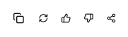

# Response actions

The gallery places the response toolbar beside its context meter.
Available in **GUI**.



## Example

```pascal
unit Docs.Ui.Ai.ResponseActions;

uses Fpas.Ui.Elements as E;
uses Fpas.Ui.Widgets.Ai.ResponseActions as W;

// Adds actions to an answer.
// ## Parameters
// - `Answer`: Text CUI copies when Copy is used.
// - `Vote`: Current vote, from minus one through one.
// ## Returns
// The toolbar with response action messages.
public function View(Answer: string; Vote: int): E.Element of W.Event;
begin
  return W.ResponseActions of W.Event('response-actions', Vote,
    function(Change: W.Event): W.Event => Change, new W.Options(CopyText := Answer));
end function;

end unit;
```

## Options and defaults

| Option | Default or requirement |
| --- | --- |
| `Vote` | Pass minus one for down, zero for neutral, or one for up. Null gives vote messages without a selected state. |
| `CopyText` | Null hides Copy. An empty string shows Copy and copies an empty string. |
| `HideRegenerate / HideShare / Enabled` | False / false / true. |

## Interaction

Click a button or press Enter or Space when it has focus. CUI copies
the supplied text and sends `Copy`. Press a selected thumb to propose
zero. Persist vote proposals and handle regeneration or sharing in the
application.

A focus request for the widget selects the first visible button. To
focus a specific button, append `/copy`, `/regenerate`, `/up`,
`/down`, or `/share` to the widget ID.

## See also

- [CUI widget inventory](../../../cui-widget-inventory.md#cui_response_actions)
- [Widget API and types](../../../../src/Fpas.Ui/Widgets/Ai/ResponseActions.fpas)
- [Gallery example](../../../../examples/ui/gui/gallery/Pages/Ai/View.fpas)
- [AI](README.md)

## Source files

- `src/Fpas.Ui.Gui/Internal/Widgets/Ai/`
  - [ResponseActions.fpas](../../../../src/Fpas.Ui.Gui/Internal/Widgets/Ai/ResponseActions.fpas)
- `src/Fpas.Ui.Gui.Cui/Interop/Ai/`
  - [NativeMethods.ResponseActions.cs](../../../../src/Fpas.Ui.Gui.Cui/Interop/Ai/NativeMethods.ResponseActions.cs)
- `src/Fpas.Ui.Gui.Cui/Widgets/Ai/`
  - [CuiWindow.ResponseActions.Types.cs](../../../../src/Fpas.Ui.Gui.Cui/Widgets/Ai/CuiWindow.ResponseActions.Types.cs)
  - [CuiWindow.ResponseActions.cs](../../../../src/Fpas.Ui.Gui.Cui/Widgets/Ai/CuiWindow.ResponseActions.cs)
- `src/Fpas.Ui.Gui.Cui/native/widgets/ai/`
  - [response_actions.c](../../../../src/Fpas.Ui.Gui.Cui/native/widgets/ai/response_actions.c)
  - [response_actions.h](../../../../src/Fpas.Ui.Gui.Cui/native/widgets/ai/response_actions.h)
