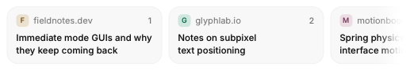

# Source list

The gallery shows source titles and domains below the answer.
Available in **GUI**.



## Example

```pascal
unit Docs.Ui.Ai.SourceList;

uses Fpas.Ui.Elements as E, Fpas.Ui.Widgets.Ai.SourceLists as W, Fpas.Ui.Widgets.Ai.Sources as S;

// Shows sources collected by the application.
// ## Parameters
// - `Documents`: Sources in display order.
// ## Returns
// The list with source indices as activation messages.
public function View(Documents: array of S.Item): E.Element<int>;
begin
  return W.SourceList<int>('sources', Documents, function(Index: int): int => Index);
end function;

end unit;
```

## Options and defaults

| Option | Default or requirement |
| --- | --- |
| `Source.Url / Title / Snippet` | Pass the URL. An empty title uses the domain. Snippet defaults to empty and is used in citation previews. |
| `Changed / Enabled` | Pass a mapper to handle source activation. Null gives a passive list. Enabled defaults to true. |

## Interaction

Scroll sideways to see more source cards. Resolve the index from
activation against the documents you supplied and handle navigation
in the application.

## See also

- [Widget API and types](../../../../src/Fpas.Ui/Widgets/Ai/SourceLists.fpas)
- [Gallery example](../../../../examples/ui/gui/gallery/Pages/Ai/View.fpas)
- [Citation](citation.md)
- [AI](README.md)
