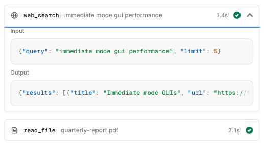

# Tool call

The gallery shows search and file-read calls. Expanding the search call
reveals its input and output JSON.
Available in **GUI**.



## Example

```pascal
unit Docs.Ui.Ai.ToolCall;

uses Fpas.Ui.Elements as E;
uses Fpas.Ui.Widgets.Ai.ToolCalls as W;
uses Fpas.Ui.Widgets.Feedback.TaskStates as T;

// Shows the result of a completed search.
// ## Parameters
// - `Input`: Recorded input display text.
// - `Output`: Recorded output display text.
// - `Seconds`: Elapsed seconds.
// ## Returns
// The disclosure for a recorded tool call.
public function View(Input: string; Output: string; Seconds: float): E.Element of string;
begin
  return W.ToolCall of string('search', 'web_search',
    new W.Options(Status := T.Status.Done, Input := Input, Output := Output, Seconds := Seconds));
end function;

end unit;
```

## Options and defaults

| Option | Default or requirement |
| --- | --- |
| `Status` | Pending. Set the current task state to display its status glyph. |
| `Seconds` | 0. CUI hides the time while pending or when the value is zero. |
| `Icon` | Empty. CUI uses the terminal glyph. Supply a glyph to replace it. |
| `Detail` | Empty. Supply a short summary to display beside the tool name. |
| `Input / Output` | Empty. Supply the payload text to display when the row opens. |
| `Enabled` | true. Set false to prevent toggling the payload details. |

## Interaction

Click a row with payload text, or focus it and press Enter or Space, to open it.
CUI uses JSON highlighting for text that starts with an object or array.
For a failed call, the output label reads **Error**. If both payloads become
empty, the row closes and leaves keyboard focus. Update the status and payloads
as your application receives them.

## See also

- [CUI widget inventory](../../../cui-widget-inventory.md#cui_tool_call)
- [Widget API and types](../../../../src/Fpas.Ui/Widgets/Ai/ToolCalls.fpas)
- [Gallery example](../../../../examples/ui/gui/gallery/Pages/Ai/View.fpas)
- [Agent status](agent-status.md)
- [AI](README.md)

## Source files

- `src/Fpas.Ui.Gui/Internal/Widgets/Ai/`
  - [ToolCall.fpas](../../../../src/Fpas.Ui.Gui/Internal/Widgets/Ai/ToolCall.fpas)
- `src/Fpas.Ui.Gui.Cui/Interop/Ai/`
  - [NativeMethods.ToolCall.cs](../../../../src/Fpas.Ui.Gui.Cui/Interop/Ai/NativeMethods.ToolCall.cs)
- `src/Fpas.Ui.Gui.Cui/Widgets/Ai/`
  - [CuiWindow.ToolCall.cs](../../../../src/Fpas.Ui.Gui.Cui/Widgets/Ai/CuiWindow.ToolCall.cs)
- `src/Fpas.Ui.Gui.Cui/native/widgets/ai/`
  - [tool_call.c](../../../../src/Fpas.Ui.Gui.Cui/native/widgets/ai/tool_call.c)
  - [tool_call.h](../../../../src/Fpas.Ui.Gui.Cui/native/widgets/ai/tool_call.h)
