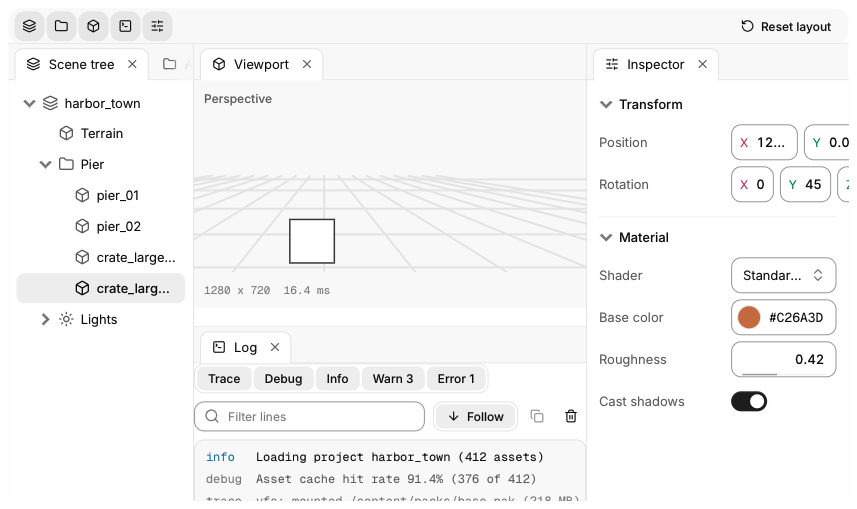

# Docking workspace

App chrome docks Scene tree and Assets together, with separate Viewport,
Log and Inspector panes.
Available in **GUI**.



## Example

```pascal
unit Docs.Ui.AppChrome.Dockspace;

uses Fpas.Ui.Elements as E;
uses Fpas.Ui.Layout as L;
uses Fpas.Ui.Widgets.Desktop.Dockspaces as W;

// Creates an editor with two dockable panels.
// ## Parameters
// - `SavedLayout`: Most recent native layout accepted by the model.
// ## Returns
// The workspace with serialized layout changes as messages.
public function View(SavedLayout: string): E.Element of string;
begin
  const Initial: string := 'dock1 h0.28([*files],[*editor])';
  const Layout: string := if SavedLayout = '' then Initial else SavedLayout end if;
  return W.Dockspace of string('editor-workspace', [
    new W.Panel of string('files', 'Files', E.Text of string('README.md')),
    new W.Panel of string('editor', 'Editor', E.Text of string('Document'))
  ], new W.Options(
    Height := L.Extent.Fixed(L.Measure.Logical(300)),
    InitialLayout := Layout,
    KnownLayout := SavedLayout
  ), function(Value: string): string => Value);
end function;

end unit;
```

## Options and defaults

| Option | Default or requirement |
| --- | --- |
| `Panels` | Include open, closed and inactive panels. Keys are stable and at most 63 UTF-8 bytes. |
| `Width / Height` | Both Fill. |
| `MinimumWidth / MinimumHeight` | Both 0. Zero uses the native minimum of 120 logical units for width and 96 for height. |
| `InitialLayout / Load / KnownLayout` | Empty / null / empty. Use Load with a new revision for each explicit restore. |
| `Shortcuts` | false. Enable window-wide shortcuts for the active group of tabs. |

## Pane layout

CUI uses the initial layout when the workspace first appears. At narrow
widths, CUI puts the open panels in one tab strip. A compact workspace shows
only the active panel and disables tab docking. As the workspace widens,
CUI shows its split panes again.

Keep panel keys stable when you change titles or move panels. Save the layout
string to restore pane positions, sizes, and tabs. To restore an existing
workspace, supply `Load` with a new `Revision`. CUI keeps the current layout
if the restore text is invalid.

## Interaction

Drag a tab to dock it or a divider to resize its pane. A panel with an
`OnOpenChanged` callback can propose a close. Accept it by updating
`Panel.Open`. Save layout proposals from `OnLayoutChanged` and pass the most
recent accepted value as `KnownLayout` to avoid repeat notifications.

## See also

- [CUI widget inventory](../../../cui-widget-inventory.md#cui_dockspace)
- [Widget API and types](../../../../src/Fpas.Ui/Widgets/Desktop/Dockspaces.fpas)
- [Gallery example](../../../../examples/ui/gui/gallery/Pages/Desktop/Workspace.fpas)
- [Split view](split-view.md)
- [Responsive layout](../../layout/responsive.md)
- [Chapter index](README.md)

## Source files

- `src/Fpas.Ui.Gui/Internal/Widgets/Desktop/`
  - [Dockspace.fpas](../../../../src/Fpas.Ui.Gui/Internal/Widgets/Desktop/Dockspace.fpas)
- `src/Fpas.Ui.Gui.Cui/Interop/Desktop/`
  - [NativeMethods.Dockspace.cs](../../../../src/Fpas.Ui.Gui.Cui/Interop/Desktop/NativeMethods.Dockspace.cs)
- `src/Fpas.Ui.Gui.Cui/Widgets/Desktop/`
  - [CuiWindow.Dockspace.Types.cs](../../../../src/Fpas.Ui.Gui.Cui/Widgets/Desktop/CuiWindow.Dockspace.Types.cs)
  - [CuiWindow.Dockspace.cs](../../../../src/Fpas.Ui.Gui.Cui/Widgets/Desktop/CuiWindow.Dockspace.cs)
- `src/Fpas.Ui.Gui.Cui/native/widgets/desktop/`
  - [dockspace.c](../../../../src/Fpas.Ui.Gui.Cui/native/widgets/desktop/dockspace.c)
  - [dockspace.h](../../../../src/Fpas.Ui.Gui.Cui/native/widgets/desktop/dockspace.h)
