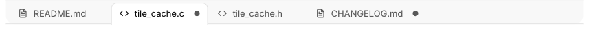

# Document tabs

The editor tab strip shows the selected file and dots for unsaved changes.
Available in **GUI**.



## Example

```pascal
unit Docs.Ui.AppChrome.DocumentTabs;

uses Fpas.Ui.Elements as E;
uses Fpas.Ui.Widgets.Desktop.DocumentTabs as W;

// Shows the current documents.
// ## Parameters
// - `Tabs`: Open documents in order.
// - `Selected`: Selected zero-based index, or -1.
// ## Returns
// A strip that reports selection, close and reorder proposals.
public function View(Tabs: array of W.Tab; Selected: int): E.Element of W.Change;
begin
  return W.DocumentTabs of W.Change('documents', Tabs, Selected,
    function(Change: W.Change): W.Change => Change,
    new W.Options(Shortcuts := true));
end function;

end unit;
```

## Options and defaults

| Option | Default or requirement |
| --- | --- |
| `Tab.Key / Title` | A stable key and visible name. |
| `Tab.Icon / Tooltip / Dirty` | Empty / empty / false. |
| `Shortcuts / Closable / Reorderable` | false / true / true. |

## Interaction

Store the ordered tabs and selected index in the model. `MoveFrom`,
`MoveTo` and `Close` use zero-based indices. `Close` refers to the original
order, while `Selected` refers to the order after a move. A value of -1
means there is no selection, close or move for the corresponding field.
Resolve the close to a document key before changing the list.

## See also

- [Widget API and types](../../../../src/Fpas.Ui/Widgets/Desktop/DocumentTabs.fpas)
- [Gallery example](../../../../examples/ui/gui/gallery/Pages/Desktop/Editor.fpas)
- [Navigation tabs](../navigation/tabs.md)
- [Chapter index](README.md)

## Source files

- `src/Fpas.Ui.Gui/Internal/Widgets/Desktop/`
  - [DocumentTabs.fpas](../../../../src/Fpas.Ui.Gui/Internal/Widgets/Desktop/DocumentTabs.fpas)
- `src/Fpas.Ui.Gui.Cui/Interop/Desktop/`
  - [NativeMethods.DocumentTabs.cs](../../../../src/Fpas.Ui.Gui.Cui/Interop/Desktop/NativeMethods.DocumentTabs.cs)
- `src/Fpas.Ui.Gui.Cui/Widgets/Desktop/`
  - [CuiWindow.DocumentTabs.Types.cs](../../../../src/Fpas.Ui.Gui.Cui/Widgets/Desktop/CuiWindow.DocumentTabs.Types.cs)
  - [CuiWindow.DocumentTabs.cs](../../../../src/Fpas.Ui.Gui.Cui/Widgets/Desktop/CuiWindow.DocumentTabs.cs)
- `src/Fpas.Ui.Gui.Cui/native/widgets/desktop/`
  - [document_tabs.c](../../../../src/Fpas.Ui.Gui.Cui/native/widgets/desktop/document_tabs.c)
  - [document_tabs.h](../../../../src/Fpas.Ui.Gui.Cui/native/widgets/desktop/document_tabs.h)
