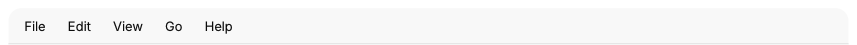
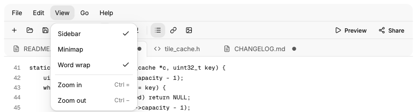

# Menu bar

App chrome places File, Edit, View, Go and Help above an editor.
Available in **GUI**.



## Example

```pascal
unit Docs.Ui.AppChrome.MenuBar;

uses Fpas.Ui.Elements as E;
uses Fpas.Ui.Widgets.Desktop.MenuBars as W;
uses Fpas.Ui.Widgets.Overlays.Menus as M;

// Shows a File menu and its commands.
// ## Returns
// A menu bar that sends the chosen command.
public function View(): E.Element of string;
begin
  return W.MenuBar of string('editor-menus', [
    new W.Menu of string('file', 'File', [
      (M.Entry of string).Action(new M.Item of string('open', 'Open…', 'open', Shortcut := 'Ctrl O')),
      (M.Entry of string).Separator,
      (M.Entry of string).Action(new M.Item of string('save', 'Save', 'save', Shortcut := 'Ctrl S'))
    ])
  ]);
end function;

end unit;
```

## Options and defaults

| Option | Default or requirement |
| --- | --- |
| `Menu.Key / Label / Entries` | A stable key, a visible title and the rows in its popup. |
| `Menu.Mnemonic / Width / Enabled` | Empty / 0 / true. Empty uses the title's first mnemonic. A width of 0 uses native sizing. |
| `HideBorder` | false. Set true to omit the bottom hairline. |

## Interaction

Click a title or use its Alt mnemonic. F10 enters menu navigation. Use
arrows to move and Enter to activate a command. Set check marks from the
model. The command's `Shortcut` string displays a hint.



## See also

- [CUI widget inventory](../../../cui-widget-inventory.md#cui_menu_bar)
- [Widget API and types](../../../../src/Fpas.Ui/Widgets/Desktop/MenuBars.fpas)
- [Gallery example](../../../../examples/ui/gui/gallery/Pages/Desktop/Editor.fpas)
- [Command menu](../actions/dropdown-menu.md)
- [Chapter index](README.md)

## Source files

- `src/Fpas.Ui.Gui/Internal/Widgets/Desktop/`
  - [MenuBar.fpas](../../../../src/Fpas.Ui.Gui/Internal/Widgets/Desktop/MenuBar.fpas)
- `src/Fpas.Ui.Gui.Cui/Interop/Desktop/`
  - [NativeMethods.MenuBar.cs](../../../../src/Fpas.Ui.Gui.Cui/Interop/Desktop/NativeMethods.MenuBar.cs)
- `src/Fpas.Ui.Gui.Cui/Widgets/Desktop/`
  - [CuiWindow.MenuBar.cs](../../../../src/Fpas.Ui.Gui.Cui/Widgets/Desktop/CuiWindow.MenuBar.cs)
- `src/Fpas.Ui.Gui.Cui/native/widgets/desktop/`
  - [menu_bar.c](../../../../src/Fpas.Ui.Gui.Cui/native/widgets/desktop/menu_bar.c)
  - [menu_bar.h](../../../../src/Fpas.Ui.Gui.Cui/native/widgets/desktop/menu_bar.h)
- `tests/Fpas.Ui.Gui.Cui.Tests/Overlays/`
  - [CuiMenuTests.cs](../../../../tests/Fpas.Ui.Gui.Cui.Tests/Overlays/CuiMenuTests.cs)
