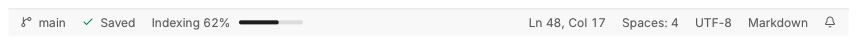

# Status bar

The editor shows the branch, saved state and indexing progress. Encoding
and language controls sit at the trailing edge.
Available in **GUI and TUI**.



## Example

```pascal
unit Docs.Ui.AppChrome.StatusBar;

uses Fpas.Ui.Elements as E, Fpas.Ui.Widgets.Desktop.StatusBars as W;

// Shows background progress and an encoding action.
// ## Parameters
// - `Progress`: Indexing fraction between zero and one.
// - `Encoding`: Name of the current document encoding.
// ## Returns
// A status bar that reports activation of the encoding item.
public function View(Progress: float; Encoding: string): E.Element<string>;
requires Progress >= 0.0F and Progress <= 1.0F;
begin
  return W.StatusBar<string>('editor-status', [
    W.Item<string>.Text(new W.Label('Saved')),
    W.Item<string>.Progress(Progress, 'Indexing', 0.0F, false),
    W.Item<string>.Spacer,
    W.Item<string>.Action('encoding', new W.Label(Encoding), 'Change encoding', true, 'encoding')
  ]);
end function;

end unit;
```

## Options and defaults

| Option | Default or requirement |
| --- | --- |
| `Items` | Use Text, Action, Progress and Spacer in display order. |
| `Label.Icon / Tone` | Empty / Neutral. |
| `HideBorder` | false. Set true to omit the top hairline. |

## Interaction

A spacer pushes subsequent items toward the trailing edge. Use a stable
key on each action and handle its message in the update. Supply progress
as a fraction and choose indeterminate progress for work without a known total.

## See also

- [Widget API and types](../../../../src/Fpas.Ui/Widgets/Desktop/StatusBars.fpas)
- [Gallery example](../../../../examples/ui/gui/gallery/Pages/Desktop/Editor.fpas)
- [Chapter index](README.md)
- [Terminal example](../../tui/app-chrome/status-bar.md)

## Source files

- `src/Fpas.Ui.Gui/Internal/Widgets/Desktop/`
  - [StatusBar.fpas](../../../../src/Fpas.Ui.Gui/Internal/Widgets/Desktop/StatusBar.fpas)
- `src/Fpas.Ui.Gui.Cui/Interop/Desktop/`
  - [NativeMethods.StatusBar.cs](../../../../src/Fpas.Ui.Gui.Cui/Interop/Desktop/NativeMethods.StatusBar.cs)
- `src/Fpas.Ui.Gui.Cui/Widgets/Desktop/`
  - [CuiWindow.StatusBar.Types.cs](../../../../src/Fpas.Ui.Gui.Cui/Widgets/Desktop/CuiWindow.StatusBar.Types.cs)
  - [CuiWindow.StatusBar.cs](../../../../src/Fpas.Ui.Gui.Cui/Widgets/Desktop/CuiWindow.StatusBar.cs)
- `src/Fpas.Ui.Gui.Cui/native/widgets/desktop/`
  - [status_bar.c](../../../../src/Fpas.Ui.Gui.Cui/native/widgets/desktop/status_bar.c)
  - [status_bar.h](../../../../src/Fpas.Ui.Gui.Cui/native/widgets/desktop/status_bar.h)
