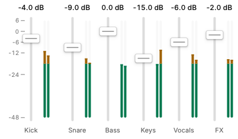

# Fader

Use a fader to change a channel gain. The gallery shows six vertical mixer
strips and a dB scale on Kick. Each strip also displays two signal peaks.
Available in **GUI**.



## Example

```pascal
unit Docs.Ui.Audio.Fader;

uses Fpas.Ui.Elements as E;
uses Fpas.Ui.Widgets.Audio.Faders as W;

// Adjusts the Kick channel and shows its current signal peaks.
// ## Parameters
// - `Gain`: Current gain between minus 48 and plus 6 dB.
// - `Peaks`: Linear amplitudes for the two channels.
// ## Returns
// The fader, with each proposed gain as an application message.
public function View(Gain: float; Peaks: array of float): E.Element of float;
begin
  return W.Fader of float('kick', 'Kick', Gain, -48.0F, 6.0F,
    function(Value: float): float => Value,
    new W.Options(UnitLabel := 'dB', Length := 180.0F,
      Ticks := [6.0F, 0.0F, -6.0F, -12.0F, -24.0F, -48.0F], Levels := Peaks));
end function;

end unit;
```

## Options and defaults

| Option | Default or requirement |
| --- | --- |
| `Value / Minimum / Maximum` | Supply finite values with increasing bounds. |
| `Step / Reset / DecimalPlaces` | 0 / 0 / 1. Zero Step allows continuous input. |
| `Length / Horizontal` | 160 logical points / false. |
| `Ticks / Levels` | Empty. Supply up to 32 ticks and up to eight linear channel peaks. |
| `UnitLabel / HideValue / Enabled` | Empty / false / true. |

## Interaction

Click or drag along the track. A focused fader accepts wheel and arrow input.
Double-click, Delete or Backspace restores Reset. Store the proposed gain in
the model, and feed new peaks as the signal changes.

## See also

- [CUI widget inventory](../../../cui-widget-inventory.md#cui_fader)
- [Widget API and types](../../../../src/Fpas.Ui/Widgets/Audio/Faders.fpas)
- [Gallery example](../../../../examples/ui/gui/gallery/Pages/Audio/View.fpas)
- [Level meter](level-meter.md)
- [Audio](README.md)

## Source files

- `src/Fpas.Ui.Gui/Internal/Widgets/Audio/`
  - [Fader.fpas](../../../../src/Fpas.Ui.Gui/Internal/Widgets/Audio/Fader.fpas)
- `src/Fpas.Ui.Gui.Cui/Interop/Audio/`
  - [NativeMethods.Fader.cs](../../../../src/Fpas.Ui.Gui.Cui/Interop/Audio/NativeMethods.Fader.cs)
- `src/Fpas.Ui.Gui.Cui/Widgets/Audio/`
  - [CuiWindow.Fader.cs](../../../../src/Fpas.Ui.Gui.Cui/Widgets/Audio/CuiWindow.Fader.cs)
- `src/Fpas.Ui.Gui.Cui/native/widgets/audio/`
  - [fader.c](../../../../src/Fpas.Ui.Gui.Cui/native/widgets/audio/fader.c)
  - [fader.h](../../../../src/Fpas.Ui.Gui.Cui/native/widgets/audio/fader.h)
