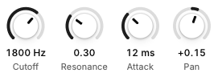

# Knob

Use a knob to adjust a value in little space. The gallery shows logarithmic
Cutoff and Attack controls, linear Resonance and a bipolar Pan control.
Available in **GUI**.



## Example

```pascal
unit Docs.Ui.Audio.Knob;

uses Fpas.Ui.Elements as E;
uses Fpas.Ui.Widgets.Audio.Knobs as W;

// Adjusts the cutoff of a filter.
// ## Parameters
// - `Hertz`: Current cutoff between 20 and 20,000 Hz.
// ## Returns
// The knob, with each proposed cutoff as an application message.
public function View(Hertz: float): E.Element of float;
begin
  return W.Knob of float('cutoff', 'Cutoff', Hertz, 20.0F, 20000.0F,
    function(Value: float): float => Value,
    new W.Options(UnitLabel := 'Hz', LogScale := true, Reset := 1000.0F));
end function;

end unit;
```

## Options and defaults

| Option | Default or requirement |
| --- | --- |
| `Label` | Supply a literal caption. An empty label omits the caption. |
| `Value / Minimum / Maximum` | Supply a finite value between finite, increasing bounds. |
| `Step` | 0. Inputs adjust continuously at zero and snap to this increment when positive. |
| `Reset` | 0. CUI clamps the reset value to the bounds and applies the step. |
| `LogScale` | false. Set true to multiply the value by equal amounts on equal turns. The minimum and ratio must be positive and finite. |
| `Bipolar` | false. Set true to draw the arc from the middle of its sweep. |
| `Format` | Null. CUI displays the value as an integer. Supply a shared numeric format for precision, sign, notation, padding and literal text. |
| `UnitLabel / HideValue` | Empty / false. Supply a unit after the value or hide the numeric caption. |
| `Size` | 48 logical units. Zero also selects the native default. |
| `ArcColor` | Automatic. CUI uses the control color. Supply a theme color or explicit RGBA color to override it. |
| `Enabled` | true. Set false to disable input. |

## Interaction

Drag vertically to turn the knob. Hold Shift for ten times finer drag input.
With focus on the knob, use the wheel over it or press an arrow key. Shift with
an arrow key and Page Up or Page Down adjust by ten steps. Home and End reach
the bounds. Double-click, Delete or Backspace restores the reset value.
Store the proposed value to accept the change.

## See also

- [CUI widget inventory](../../../cui-widget-inventory.md#cui_knob)
- [Widget API and types](../../../../src/Fpas.Ui/Widgets/Audio/Knobs.fpas)
- [Gallery example](../../../../examples/ui/gui/gallery/Pages/Audio/View.fpas)
- [Audio](README.md)

## Source files

- `src/Fpas.Ui.Gui/Internal/Widgets/Audio/`
  - [Knob.fpas](../../../../src/Fpas.Ui.Gui/Internal/Widgets/Audio/Knob.fpas)
- `src/Fpas.Ui.Gui.Cui/Interop/Audio/`
  - [NativeMethods.Knob.cs](../../../../src/Fpas.Ui.Gui.Cui/Interop/Audio/NativeMethods.Knob.cs)
- `src/Fpas.Ui.Gui.Cui/Widgets/Audio/`
  - [CuiWindow.Knob.cs](../../../../src/Fpas.Ui.Gui.Cui/Widgets/Audio/CuiWindow.Knob.cs)
- `src/Fpas.Ui.Gui.Cui/native/widgets/audio/`
  - [knob.c](../../../../src/Fpas.Ui.Gui.Cui/native/widgets/audio/knob.c)
  - [knob.h](../../../../src/Fpas.Ui.Gui.Cui/native/widgets/audio/knob.h)
