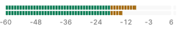

# Level meter

Use a level meter for signal peaks and clipping. The gallery draws the stereo
master as two horizontal bars with segmented fill and a dB scale.
Available in **GUI**.



## Example

```pascal
unit Docs.Ui.Audio.LevelMeter;

uses Fpas.Ui.Elements as E;
uses Fpas.Ui.Widgets.Audio.LevelMeters as W;

// Displays a two-channel master meter.
// ## Parameters
// - `Left`: Linear peak of the left channel.
// - `Right`: Linear peak of the right channel.
// ## Returns
// The meter with a message for a cleared clip indicator.
public function View(Left: float; Right: float): E.Element of string;
begin
  return W.LevelMeter of string('master', [Left, Right],
    new W.Options(Length := 240.0F, Horizontal := true, Scale := true, Segmented := true),
    function(): string => 'clip-cleared');
end function;

end unit;
```

## Options and defaults

| Option | Default or requirement |
| --- | --- |
| `Levels` | One to eight finite, nonnegative linear peaks. 1.0 represents 0 dBFS. |
| `MinimumDb / MaximumDb` | −60 / +6 dBFS. Zero MaximumDb uses +6. |
| `Length / Thickness` | 160 / 6 logical points. |
| `Horizontal / Scale / Segmented` | All false. |
| `Hold / Decay` | 1.5 seconds / 20 dB per second. A negative Hold disables it. Zero selects the native hold time. |

## Interaction

Pass fresh peaks as frames update. CUI applies decay, shows the held peaks
and latches the clip indicators. Clicking a lit indicator clears it and calls
`OnClipCleared` if supplied.

## See also

- [CUI widget inventory](../../../cui-widget-inventory.md#cui_level_meter)
- [Widget API and types](../../../../src/Fpas.Ui/Widgets/Audio/LevelMeters.fpas)
- [Gallery example](../../../../examples/ui/gui/gallery/Pages/Audio/View.fpas)
- [Audio](README.md)

## Source files

- `src/Fpas.Ui.Gui/Internal/Widgets/Audio/`
  - [LevelMeter.fpas](../../../../src/Fpas.Ui.Gui/Internal/Widgets/Audio/LevelMeter.fpas)
- `src/Fpas.Ui.Gui.Cui/Interop/Audio/`
  - [NativeMethods.LevelMeter.cs](../../../../src/Fpas.Ui.Gui.Cui/Interop/Audio/NativeMethods.LevelMeter.cs)
- `src/Fpas.Ui.Gui.Cui/Widgets/Audio/`
  - [CuiWindow.LevelMeter.cs](../../../../src/Fpas.Ui.Gui.Cui/Widgets/Audio/CuiWindow.LevelMeter.cs)
- `src/Fpas.Ui.Gui.Cui/native/widgets/audio/`
  - [level_meter.c](../../../../src/Fpas.Ui.Gui.Cui/native/widgets/audio/level_meter.c)
  - [level_meter.h](../../../../src/Fpas.Ui.Gui.Cui/native/widgets/audio/level_meter.h)
- `tests/Fpas.Ui.Gui.Cui.Tests/Feedback/`
  - [CuiLevelMeterTests.cs](../../../../tests/Fpas.Ui.Gui.Cui.Tests/Feedback/CuiLevelMeterTests.cs)
