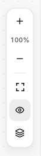

# Canvas controls

Use canvas controls to place a zoom rail over a canvas. The gallery adds
Grid and Layers toggles.
Available in **GUI**.



## Example

```pascal
unit Docs.Ui.CanvasAndBars.CanvasControls;

uses Fpas.Ui.Elements as E;
uses Fpas.Ui.Widgets.Canvas.CanvasControls as W;
uses Fpas.Ui.Widgets.Editors.NodeEditors as N;

// Adds zoom and fit controls to a canvas child.
// ## Parameters
// - `Child`: Canvas under the rail.
// - `Viewport`: Current pan and zoom.
// - `Toggles`: Glyphs, labels and states for additional toggles.
// ## Returns
// The canvas with viewport and toggle proposals.
public function View(Child: E.Element of W.Event; Viewport: N.View; Toggles: array of W.Toggle): E.Element of W.Event;
begin
  return W.CanvasControls of W.Event('zoom-rail', Viewport, Toggles,
    function(Change: W.Event): W.Event => Change, Child);
end function;

end unit;
```

## Options and defaults

| Option | Default or requirement |
| --- | --- |
| `Content` | `null`. Supply `X`, `Y`, `Width` and `Height` in canvas coordinates for Fit. |
| `Steps` | Empty. The default presets are 25%, 33%, 50%, 67%, 80%, 100%, 125%, 150%, 200%, 300% and 400%. Custom presets must be finite, positive and strictly increasing. |
| `HideFit` | `false`. Set to `true` to hide Fit. |
| `StartSide` | `false`. The rail is centered vertically on the logical end edge. Set to `true` for the start edge. |
| `Enabled` | `true`. Set to `false` to disable input from the rail. |

The start edge is left in left-to-right layouts and right in right-to-left
layouts. Pass toggles in display order. Each `Toggle` takes a CUI glyph
(`Icon`), tooltip caption (`Label`) and pressed state (`On`). By default a
toggle shows a circle glyph, has no tooltip and starts off.

## Interaction

Plus and minus move to the next or previous preset and stop at the ends.
Click the percentage to reset the zoom to 100%. Zoom actions keep the same
canvas point in the center. Tab moves through the available buttons. Enter
or Space activates the focused button.

Share the viewport with the node editor or another canvas child. The
viewport's `X` and `Y` give the canvas origin relative to the child.
`Zoom` is the scale. Both zero and one represent 100%.

Fit computes a zoom that uses 90% of the canvas along the limiting
dimension. Fit limits the zoom to the preset range and centers the bounds.
If either bound dimension is zero or `Content` is `null`, Fit only reports
the request. Compute the new viewport in the application in that case.

Keep `Content` bounds current when objects move, including positions before
the canvas origin. The gallery computes conservative bounds for its three
fixed node specimens in [SampleBounds](../../../../examples/ui/gui/gallery/Pages/Canvas/SampleBounds.fpas).

## Results

Store the proposed `Viewport` and `Toggles` in the model. `Toggles` gives
one state per toggle in display order. One proposal can contain several
action flags.

| Flag | Meaning |
| --- | --- |
| `Fit` | The user activated Fit. |
| `Zoomed` | A zoom action set a new target or Fit set a target from bounds. |
| `Toggled` | A toggle changed. |

Zoom and Fit can propose further viewport changes as the animation runs.
The action flags mark the activation frame. With reduced motion, the
viewport jumps to the target.

## See also

- [CUI widget inventory](../../../cui-widget-inventory.md#cui_canvas_controls)
- [CUI icon button focus](../../../future/cui-upstream-bugs.md#cui-031)
- [Widget API and types](../../../../src/Fpas.Ui/Widgets/Canvas/CanvasControls.fpas)
- [Gallery example](../../../../examples/ui/gui/gallery/Pages/Canvas/View.fpas)
- [Node editor](node-editor.md)
- [Canvas and bars](README.md)

## Source files

- `src/Fpas.Ui.Gui/Internal/Widgets/Canvas/`
  - [CanvasControls.fpas](../../../../src/Fpas.Ui.Gui/Internal/Widgets/Canvas/CanvasControls.fpas)
- `src/Fpas.Ui.Gui.Cui/Interop/Canvas/`
  - [NativeMethods.CanvasControls.cs](../../../../src/Fpas.Ui.Gui.Cui/Interop/Canvas/NativeMethods.CanvasControls.cs)
- `src/Fpas.Ui.Gui.Cui/Widgets/Canvas/`
  - [CuiWindow.CanvasControls.Types.cs](../../../../src/Fpas.Ui.Gui.Cui/Widgets/Canvas/CuiWindow.CanvasControls.Types.cs)
  - [CuiWindow.CanvasControls.cs](../../../../src/Fpas.Ui.Gui.Cui/Widgets/Canvas/CuiWindow.CanvasControls.cs)
- `src/Fpas.Ui.Gui.Cui/native/widgets/canvas/`
  - [canvas_controls.c](../../../../src/Fpas.Ui.Gui.Cui/native/widgets/canvas/canvas_controls.c)
  - [canvas_controls.h](../../../../src/Fpas.Ui.Gui.Cui/native/widgets/canvas/canvas_controls.h)
