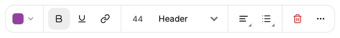

# Format bar

Edit the color, emphasis, style, alignment, and list format of a text selection.
The format bar also requests link editing, deletion, and other actions.
Available in **GUI**.



## Example

```pascal
unit Docs.Ui.CanvasAndBars.FormatBar;

uses Fpas.Ui.Elements as E;
uses Fpas.Ui.Widgets.Canvas.FormatBars as W;

// Shows formatting for the current text selection.
// ## Parameters
// - `Current`: The format of the current selection.
// ## Returns
// The format bar with edits and actions as messages.
public function View(Current: W.Value): E.Element of W.Event;
begin
  return W.FormatBar of W.Event('format-selection', Current,
    function(Change: W.Event): W.Event => Change);
end function;

end unit;
```

## Options and defaults

| Option | Default or requirement |
| --- | --- |
| `Styles` | Empty uses Header, Title, Subtitle, and Normal text with document sizes 44, 56, 28, and 16. |
| `Colors` | Empty uses Neutral, Rose, Danger, Warning, Success, Teal, Info, and Violet. Supply up to 32 tones in display order. Neutral uses the theme text color. |
| `Footer` | Null shows `Text options`. An empty string hides the caption. |
| `FooterKeys` | Null shows `Ctrl Alt 0`. An empty string hides the keycaps. The application implements any shortcut. |
| `DeleteQuestion` | Null shows `Delete this text?`. Supply a custom string for the question. |
| `HideDelete` | `false`. Set to `true` to omit Delete. |
| `HideMore` | `false`. Set to `true` to omit the application's More action. |
| `Enabled` | `true`. Set to `false` to close the menus and disable input. |

Each custom style has a literal `Name`, a document `Size`, a `PreviewSize`
in logical units, and a `Font` from `Fpas.Ui.Graphics`. A zero
`PreviewSize` uses the theme body size.
The default previews use 17, 22, and 15 logical units in the medium font,
and 13 in the body font.

Pass the current selection as `Value` on each frame.

| Field | Meaning |
| --- | --- |
| `Color` | Current theme tone for text. |
| `Bold`, `Underline` | Current emphasis flags. |
| `Link` | Current link state. The link button appears pressed when this is `true`. |
| `Style` | Zero-based index into the displayed styles. |
| `Size` | The document size shown in the readout. Choosing a style copies that style's size. |
| `Alignment` | Left (0), center (1), right (2), or justify (3). |
| `List` | None (0), bulleted (1), numbered (2), or checklist (3). Choosing the current list kind clears it. |

Document sizes and preview sizes must be finite and nonnegative. The style
index, alignments, list kinds, tones, and preview fonts must be valid.

## Proposals

The widget calls the supplied callback when a format field changes or the user
activates an action. Handle each flag that is set in the same `Event`.

| Field | Meaning |
| --- | --- |
| `Format` | Proposed format for the selection. |
| `Changed` | One or more format fields changed. Apply `Format` to the selection. |
| `ToggleLink` | The user activated Link. The application owns the edit and updates `Value.Link`. |
| `Delete` | The user confirmed deletion or chose Delete in the toolbar overflow menu. |
| `More` | The user activated the application's More action. |

## Interaction

Use Tab to move through the visible controls. Enter or Space activates the
focused control. Down opens the color, style, alignment, or list menu.
Use the arrow keys to move through the choices, Enter to choose, and Escape
to dismiss. If the current tone is absent, opening the color grid from the
keyboard focuses the first swatch.

Activate Delete to open its question. Select Delete in that question to
confirm, or press Escape to cancel.

In a narrow layout, the **More tools** menu contains controls that CUI moves
to the overflow. Alignment and list cycle through their choices there.
The color and style controls can disappear at narrow widths.
[CUI-169](../../../future/cui-upstream-bugs.md#cui-169)

## See also

- [CUI widget inventory](../../../cui-widget-inventory.md#cui_format_bar)
- [Widget API and types](../../../../src/Fpas.Ui/Widgets/Canvas/FormatBars.fpas)
- [Gallery example](../../../../examples/ui/gui/gallery/Pages/Canvas/View.fpas)
- [Canvas and bars](README.md)

## Source files

- `src/Fpas.Ui.Gui/Internal/Widgets/Canvas/`
  - [FormatBar.fpas](../../../../src/Fpas.Ui.Gui/Internal/Widgets/Canvas/FormatBar.fpas)
- `src/Fpas.Ui.Gui.Cui/Interop/Canvas/`
  - [NativeMethods.FormatBar.cs](../../../../src/Fpas.Ui.Gui.Cui/Interop/Canvas/NativeMethods.FormatBar.cs)
- `src/Fpas.Ui.Gui.Cui/Widgets/Canvas/`
  - [CuiWindow.FormatBar.Types.cs](../../../../src/Fpas.Ui.Gui.Cui/Widgets/Canvas/CuiWindow.FormatBar.Types.cs)
  - [CuiWindow.FormatBar.cs](../../../../src/Fpas.Ui.Gui.Cui/Widgets/Canvas/CuiWindow.FormatBar.cs)
- `src/Fpas.Ui.Gui.Cui/native/widgets/canvas/`
  - [format_bar.c](../../../../src/Fpas.Ui.Gui.Cui/native/widgets/canvas/format_bar.c)
  - [format_bar.h](../../../../src/Fpas.Ui.Gui.Cui/native/widgets/canvas/format_bar.h)
- `src/Fpas.Ui.Gui.Cui/native/tests/`
  - [canvas_format_bar.c](../../../../src/Fpas.Ui.Gui.Cui/native/tests/canvas_format_bar.c)
