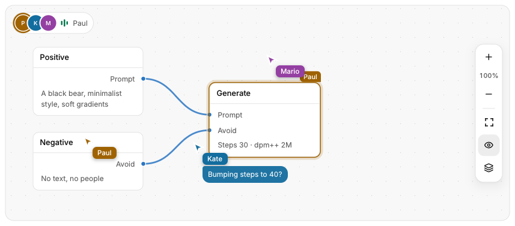

# Live cursors

Use live cursors for a shared canvas. The gallery shows named pointers
and a short speech bubble.
Available in **GUI**.



## Example

```pascal
unit Docs.Ui.CanvasAndBars.LiveCursors;

uses Fpas.Ui.Elements as E;
uses Fpas.Ui.Widgets.Canvas.LiveCursors as W;
uses Fpas.Ui.Widgets.Editors.NodeEditors as N;

// Overlays collaborator positions on the current canvas.
// ## Parameters
// - `Child`: Content under the cursors.
// - `People`: Collaborator names, positions and presentation state.
// - `Viewport`: Current canvas transform.
// ## Returns
// The child with native cursors drawn over it.
public function View(Child: E.Element of string; People: array of W.Person; Viewport: N.View): E.Element of string;
begin
  return W.LiveCursors of string('collaborators', People, Child, new W.Options(View := Viewport));
end function;

end unit;
```

## Options and defaults

| Option | Default or requirement |
| --- | --- |
| `Person.Name` | Supply a nonempty, unique name that stays the same across updates. |
| `Person.X` / `Y` | `0` / `0`. Supply positions in logical units. |
| `Person.Says` | `null`. Supply text for the cursor's speech bubble. |
| `Person.Away` | `false`. Set to `true` to hide the cursor. |
| `Person.Tone` / `Color` | `Neutral` / `null`. An explicit `Color` takes priority. With the neutral tone, CUI chooses a theme tone from the name. |
| `View` | `null`. Positions are relative to the child's top-left corner. Supply a view to apply its canvas pan and zoom. |
| `NoGlide` | `false`. Set to `true` to apply each new position immediately. |

## Interaction

Update the model when the application receives new positions. Keep the same
canvas transform for the child and cursor overlay so they pan and zoom together.
CUI clips the cursors to the child. The cursors take no input or focus.
Reduced motion applies positions immediately.

The gallery sends a typed message every 400 ms while the Canvas and bars page
is open. The message advances the synthetic collaborator positions in the model.
Use a [frame request](../host.md#invalidation-and-inspection) when only painting
needs to run again.

## See also

- [CUI widget inventory](../../../cui-widget-inventory.md#cui_live_cursors)
- [Widget API and types](../../../../src/Fpas.Ui/Widgets/Canvas/LiveCursors.fpas)
- [Gallery example](../../../../examples/ui/gui/gallery/Pages/Canvas/View.fpas)
- [Presence pill](presence-pill.md)
- [Canvas and bars](README.md)

## Source files

- `src/Fpas.Ui.Gui/Internal/Widgets/Canvas/`
  - [LiveCursors.fpas](../../../../src/Fpas.Ui.Gui/Internal/Widgets/Canvas/LiveCursors.fpas)
- `src/Fpas.Ui.Gui.Cui/Interop/Canvas/`
  - [NativeMethods.LiveCursors.cs](../../../../src/Fpas.Ui.Gui.Cui/Interop/Canvas/NativeMethods.LiveCursors.cs)
- `src/Fpas.Ui.Gui.Cui/Widgets/Canvas/`
  - [CuiWindow.LiveCursors.Types.cs](../../../../src/Fpas.Ui.Gui.Cui/Widgets/Canvas/CuiWindow.LiveCursors.Types.cs)
  - [CuiWindow.LiveCursors.cs](../../../../src/Fpas.Ui.Gui.Cui/Widgets/Canvas/CuiWindow.LiveCursors.cs)
- `src/Fpas.Ui.Gui.Cui/native/widgets/canvas/`
  - [live_cursors.c](../../../../src/Fpas.Ui.Gui.Cui/native/widgets/canvas/live_cursors.c)
  - [live_cursors.h](../../../../src/Fpas.Ui.Gui.Cui/native/widgets/canvas/live_cursors.h)
