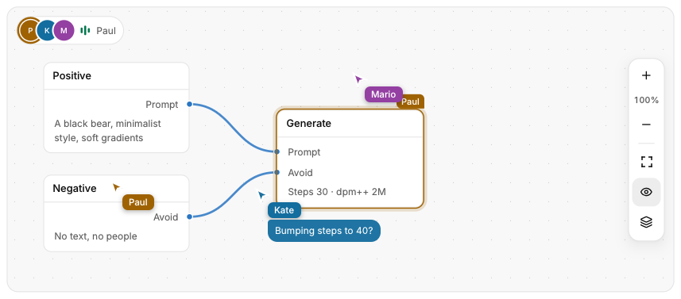

# Node editor

Use a node editor for a visual graph with composed node bodies.
The gallery connects prompt nodes to an image generation node.
Available in **GUI**.



## Example

```pascal
unit Docs.Ui.CanvasAndBars.NodeEditor;

uses Fpas.Ui.Elements as E;
uses Fpas.Ui.Widgets.Editors.NodeEditors as W;

// Shows a model-owned graph.
// ## Parameters
// - `Viewport`: Pan position and zoom.
// - `Nodes`: Nodes with unique IDs, positions, pins and optional bodies.
// - `Links`: Connections from output to input pin IDs.
// ## Returns
// The node editor with native input proposals.
public function View(Viewport: W.View; Nodes: array of W.Node of W.Event; Links: array of W.Link): E.Element of W.Event;
begin
  return W.NodeEditor of W.Event('graph', Viewport, Nodes, Links,
    function(Change: W.Event): W.Event => Change);
end function;

end unit;
```

## Options and defaults

| Editor option | Default or behavior |
| --- | --- |
| `Width` | Fill the available width. |
| `Height` | 440 logical points. |
| `MinimumZoom` | Zero uses the CUI default of 0.25. |
| `MaximumZoom` | Zero or a value at or below the minimum uses the greater of 2 and the effective minimum. |
| `HideGrid` | False. Set to true to hide the canvas grid. |
| `Minimap` | False. Set to true to add a navigable graph overview. |
| `Enabled` | True. Set to false to disable input and proposals. |
| `ObservedStatus` | Null. Supply the model's last `Status` to receive updates. Start with `new Status()`. |

The viewport defaults to an origin of `(0, 0)` and a zoom of 1. CUI treats a
zoom of zero as 1 and clamps the result to the configured bounds.
Use `Content` to select the CUI default for an extent.

| Graph value | Default or requirement |
| --- | --- |
| `Node.Id`, `Link.Id` | Use a unique integer ID within each group. |
| `Node.X`, `Node.Y`, `Node.Title` | Set the canvas position and visible title. |
| `Node.Width` | Zero uses the CUI default of 184 canvas units. |
| `Node.Icon` | Null. Supply a glyph to display before the title. |
| `Node.Pins` | Draw pins in array order. |
| `Node.Body` | Null. Supply a widget or layout to draw below the pin rows. |
| `Node.Ring` | Null. Supply [selection ring options](selection-ring.md) to mark a collaborator's selection. |
| `Pin.Id`, `Pin.Label`, `Pin.Output` | Use a pin ID unique in the editor. Set the caption and direction. True places the pin on the output side. |
| `Pin.Kind` | Zero or a negative value accepts any kind. Positive kinds use a color from the series palette and connect to the same kind or a wildcard. |
| `Link.FromPin`, `Link.ToPin` | Supply an output pin ID and an input pin ID. |

CUI lays out each body at 100 percent and scales it with the canvas. Body text
is sharpest at 100 percent and below. Menus that bodies open use 100 percent
placement. A node body can contain ordinary widgets and layouts.
Keep other node editors outside the body.

## Results

The model owns the viewport and graph. Handle a proposal in the update function
and return the resulting values in the next view.

| Event | Result |
| --- | --- |
| `Pan` | The proposed viewport position and zoom. |
| `Move` | The moved node ID and its proposed canvas coordinates. |
| `Connect` | The proposed output and input pin IDs, in that order. |
| `Unlink` | The ID of the detached, replaced, or deleted link. |
| `Delete` | The ID of a deleted node. CUI also reports the node's links through `Unlink`. |
| `StatusChanged` | Selected node IDs, connected pin IDs, and selected link IDs from CUI in drawing order. |

Store the new `Status` in the model and pass it as `ObservedStatus` in the
next view. FPAS reports the final node selection after it submits all nodes.
CUI reads pin connections from the preceding frame and accounts for links
that the user is dragging off an input. Use `ConnectedPins` to decide which
node bodies to show. The low-level `CuiWindow` API returns each native result
from `BeginNode`, `NodePin`, and `NodeLink`. Call `IsNodeSelected` after
submitting all nodes to read the final selection while the editor is open.

## Interaction

- Scroll to zoom around the pointer. Drag with the middle mouse button or hold
  Space and drag to pan. Click the minimap to move the viewport.
- Click a node to select it. Shift-click to add it or use the primary modifier
  to toggle it. Drag the empty canvas to select nodes in a rectangle.
- Drag a selected node to move the selection. Drag between compatible pins on
  different nodes to connect them. An input accepts one link. A new connection
  replaces its link.
- Drag a link's input end away to detach it. Click a wire and press Delete to
  remove it.
- Use Tab to focus and select a node. Use arrow keys to move the selection
  10 canvas units, or hold Shift to move it one unit.
- Use Delete or Backspace to remove the selection. Use the primary modifier
  with A to select all nodes. Press Esc to cancel a wire drag or clear selection.
- Press F to frame all nodes. Press + or - to zoom, or 0 to return to 100 percent
  within the zoom bounds. Use the pointer to create links.

## See also

- [CUI widget inventory](../../../cui-widget-inventory.md#cui_node_editor_begin)
- [CUI node editor reference](https://github.com/yappologistic/CUI/blob/6864776/docs/components-more.md#node-editor)
- [Widget API and types](../../../../src/Fpas.Ui/Widgets/Editors/NodeEditors.fpas)
- [Gallery example](../../../../examples/ui/gui/gallery/Pages/Canvas/View.fpas)
- [Canvas controls](canvas-controls.md)
- [Selection ring](selection-ring.md)
- [Canvas and bars](README.md)

## Source files

- `src/Fpas.Ui.Gui/Internal/Widgets/Editors/`
  - [NodeEditor.fpas](../../../../src/Fpas.Ui.Gui/Internal/Widgets/Editors/NodeEditor.fpas)
- `src/Fpas.Ui.Gui.Cui/Interop/Editors/`
  - [NativeMethods.NodeEditor.cs](../../../../src/Fpas.Ui.Gui.Cui/Interop/Editors/NativeMethods.NodeEditor.cs)
- `src/Fpas.Ui.Gui.Cui/Widgets/Editors/`
  - [CuiWindow.NodeEditor.Types.cs](../../../../src/Fpas.Ui.Gui.Cui/Widgets/Editors/CuiWindow.NodeEditor.Types.cs)
  - [CuiWindow.NodeEditor.cs](../../../../src/Fpas.Ui.Gui.Cui/Widgets/Editors/CuiWindow.NodeEditor.cs)
- `src/Fpas.Ui.Gui.Cui/native/widgets/editors/`
  - [node_editor.c](../../../../src/Fpas.Ui.Gui.Cui/native/widgets/editors/node_editor.c)
  - [node_editor.h](../../../../src/Fpas.Ui.Gui.Cui/native/widgets/editors/node_editor.h)
