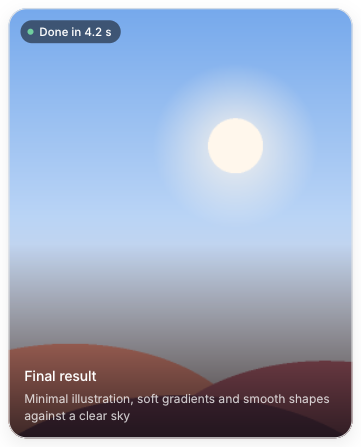

# Result card

Use a result card for a visual output. The gallery presents an image
with a caption and elapsed-time badge.
Available in **GUI**.



## Example

```pascal
unit Docs.Ui.CanvasAndBars.ResultCard;

uses Fpas.Ui.Elements as E;
uses Fpas.Ui.Widgets.Canvas.ResultCards as W;
uses Fpas.Ui.Widgets.Media.MediaImages as M;

// Shows the output image and offers a preview.
// ## Parameters
// - `Picture`: A file or an immutable RGBA picture.
// ## Returns
// The card with a message to open the preview.
public function View(Picture: M.Source): E.Element of string;
begin
  return W.ResultCard of string('result', Picture, 'Final result', 'show-preview',
    new W.Options(Caption := 'Generated illustration', Badge := 'Done'));
end function;

end unit;
```

## Options and defaults

| Option | Default or requirement |
| --- | --- |
| `Image` | Supply a file or RGBA picture. Pass `null` to draw a muted surface. |
| `Title` | Pass an empty string to omit the title. |
| `Caption` | `null` omits the caption. A caption wraps below the title. |
| `Badge` | `null` omits the status chip. The chip appears at the top of the card. |
| `BadgeTone` | `Neutral` uses the native success color for the chip dot. |
| `Width` | `Content` fills the available width up to 320 logical units. `Fill`, `Fixed`, and `Percent` set an explicit extent. |
| `Aspect` | Card height divided by width. Zero uses 1.25. |
| `StretchImage` | `false` centers and crops the image to fill the card. Set `true` to stretch the image. |
| `Enabled` | `true` lets the card receive focus and activate. |

## Interaction

Click the card or focus it with Tab and press Enter or Space. The GUI host sends
the supplied `Activate` message. A disabled card stays visible and ignores these
inputs. Place export tools in a separate floating toolbar below the card.

The title and caption stay light over the dark fade in both themes.

## See also

- [CUI widget inventory](../../../cui-widget-inventory.md#cui_result_card)
- [Widget API and types](../../../../src/Fpas.Ui/Widgets/Canvas/ResultCards.fpas)
- [Gallery example](../../../../examples/ui/gui/gallery/Pages/Canvas/View.fpas)
- [Toolbar](toolbar.md)
- [Canvas and bars](README.md)

## Source files

- `src/Fpas.Ui.Gui/Internal/Widgets/Canvas/`
  - [ResultCard.fpas](../../../../src/Fpas.Ui.Gui/Internal/Widgets/Canvas/ResultCard.fpas)
- `src/Fpas.Ui.Gui.Cui/Interop/Canvas/`
  - [NativeMethods.ResultCard.cs](../../../../src/Fpas.Ui.Gui.Cui/Interop/Canvas/NativeMethods.ResultCard.cs)
- `src/Fpas.Ui.Gui.Cui/Widgets/Canvas/`
  - [CuiWindow.ResultCard.cs](../../../../src/Fpas.Ui.Gui.Cui/Widgets/Canvas/CuiWindow.ResultCard.cs)
- `src/Fpas.Ui.Gui.Cui/native/widgets/canvas/`
  - [result_card.c](../../../../src/Fpas.Ui.Gui.Cui/native/widgets/canvas/result_card.c)
  - [result_card.h](../../../../src/Fpas.Ui.Gui.Cui/native/widgets/canvas/result_card.h)
- `src/Fpas.Ui.Gui.Cui/native/tests/`
  - [canvas_cards.c](../../../../src/Fpas.Ui.Gui.Cui/native/tests/canvas_cards.c)
