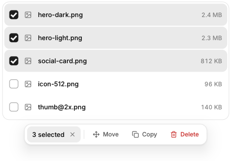

# Selection bar

Use a selection bar for bulk operations. The gallery shows a selected
file count and actions beneath the file list.
Available in **GUI**.



## Example

```pascal
unit Docs.Ui.CanvasAndBars.SelectionBar;

uses Fpas.Ui.Elements as E;
uses Fpas.Ui.Widgets.Canvas.SelectionBars as W;

// Adds a bulk action bar to a list.
// ## Parameters
// - `Child`: List that anchors the floating bar.
// - `Selected`: Selection flags in the list's order.
// - `Actions`: Action glyphs, captions and tones in display order.
// ## Returns
// The list with bulk action and clear proposals.
public function View(
  Child: E.Element of W.Event;
  Selected: array of bool;
  Actions: array of W.Action
): E.Element of W.Event;
begin
  return W.SelectionBar of W.Event('bulk-files', W.Selection.Items(Selected), Actions,
    function(Change: W.Event): W.Event => Change, Child);
end function;

end unit;
```

## Options and defaults

| Option | Default or requirement |
| --- | --- |
| `Selected` | Supply `Selection.Items(Flags)` or `Selection.Count(Count)`. The count must be nonnegative. |
| `Actions` | Supply actions in display order. Each action has a `Label`, an optional glyph in `Icon`, and a `Tone`. |
| `Child` | The component that anchors the bar. Use a list, table, grid, or other rendered element. |
| `NoEscape` | `false` lets Escape clear the selection. Set `true` to keep the selection when Escape is pressed. |
| `Enabled` | `true` lets the bar accept activation and clear requests. |
| `CountFormat` | An empty string uses `%d selected`. A custom format accepts one `%d` slot at most and `%%` for a percent sign. |

Use an empty `Icon` for a text-only action. `Tone.Neutral` uses the native
secondary text color. Use `Tone.Danger` for a destructive action.

## Interaction

The bar floats below `Child` and mirrors its controls in right-to-left layout.
It slides in when the count becomes positive and slides out when the count
returns to zero. The bar displays the last count while it slides out.

Tab reaches the clear button and actions after the child's controls. Click a
control or focus it and press Enter or Space. An open popover or dialog takes
keyboard input before the bar.

For an action, `Event.Index` is the zero-based action index and `Event.Clear`
is false. Apply the action to the selected items in the update function. For
the clear button or Escape, `Event.Index` is -1 and `Event.Clear` is true.
Clear the flags or set the aggregate count to zero in the model. The GUI host
sends no message while the bar is idle or disabled. The host keeps the
model's flags unchanged until the update function processes the clear message.

## See also

- [CUI widget inventory](../../../cui-widget-inventory.md#cui_selection_bar)
- [Widget API and types](../../../../src/Fpas.Ui/Widgets/Canvas/SelectionBars.fpas)
- [Gallery example](../../../../examples/ui/gui/gallery/Pages/Canvas/View.fpas)
- [Canvas and bars](README.md)

## Source files

- `src/Fpas.Ui.Gui/Internal/Widgets/Canvas/`
  - [SelectionBar.fpas](../../../../src/Fpas.Ui.Gui/Internal/Widgets/Canvas/SelectionBar.fpas)
- `src/Fpas.Ui.Gui.Cui/Interop/Canvas/`
  - [NativeMethods.SelectionBar.cs](../../../../src/Fpas.Ui.Gui.Cui/Interop/Canvas/NativeMethods.SelectionBar.cs)
- `src/Fpas.Ui.Gui.Cui/Widgets/Canvas/`
  - [CuiWindow.SelectionBar.Types.cs](../../../../src/Fpas.Ui.Gui.Cui/Widgets/Canvas/CuiWindow.SelectionBar.Types.cs)
  - [CuiWindow.SelectionBar.cs](../../../../src/Fpas.Ui.Gui.Cui/Widgets/Canvas/CuiWindow.SelectionBar.cs)
- `src/Fpas.Ui.Gui.Cui/native/widgets/canvas/`
  - [selection_bar.c](../../../../src/Fpas.Ui.Gui.Cui/native/widgets/canvas/selection_bar.c)
  - [selection_bar.h](../../../../src/Fpas.Ui.Gui.Cui/native/widgets/canvas/selection_bar.h)
- `src/Fpas.Ui.Gui.Cui/native/tests/`
  - [canvas_cards.c](../../../../src/Fpas.Ui.Gui.Cui/native/tests/canvas_cards.c)
