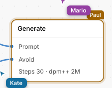

# Selection ring

Use a selection ring to identify another person's selection. The gallery
places Paul's ring on the Generate node.
Available in **GUI**.



## Example

```pascal
unit Docs.Ui.CanvasAndBars.SelectionRing;

uses Fpas.Ui.Elements as E;
uses Fpas.Ui.Styles as S;
uses Fpas.Ui.Widgets.Canvas.SelectionRings as W;

// Marks a selected object with its owner's name.
// ## Parameters
// - `Child`: Object that receives the ring.
// - `Owner`: Collaborator label.
// ## Returns
// The child with the native selection ring.
public function View(Child: E.Element of string; Owner: string): E.Element of string;
begin
  return W.SelectionRing of string('remote-selection', Child,
    new W.Options(Tone := S.Tone.Warning, Name := Owner));
end function;

end unit;
```

## Options and defaults

| Option | Default or requirement |
| --- | --- |
| `Tone` | Neutral uses the CUI emphasis color. Set a tone to use its theme color. |
| `Color` | Null uses the tone. Supply an explicit color to override the tone. CUI uses its emphasis color when the explicit color has zero alpha. |
| `Name` | Null. Supply a name to add a flag to the top end corner. The flag follows the reading direction. |
| `Radius` | Zero uses the child's top-left corner radius. Supply a radius in logical points to override it. |

## Interaction

Wrap the selected child. CUI draws the ring around the previous widget after
the child draws. For a node editor card, set the node's `Ring` options.
Draw the ring for the object that the model identifies as selected.

## See also

- [CUI widget inventory](../../../cui-widget-inventory.md#cui_live_cursors)
- [CUI collaborator reference](https://github.com/yappologistic/CUI/blob/6864776/docs/components-more.md#live-cursors)
- [Widget API and types](../../../../src/Fpas.Ui/Widgets/Canvas/SelectionRings.fpas)
- [Gallery example](../../../../examples/ui/gui/gallery/Pages/Canvas/View.fpas)
- [Node editor](node-editor.md)
- [Canvas and bars](README.md)

## Source files

- `src/Fpas.Ui.Gui/Internal/Widgets/Canvas/`
  - [SelectionRing.fpas](../../../../src/Fpas.Ui.Gui/Internal/Widgets/Canvas/SelectionRing.fpas)
- `src/Fpas.Ui.Gui.Cui/Interop/Canvas/`
  - [NativeMethods.SelectionRing.cs](../../../../src/Fpas.Ui.Gui.Cui/Interop/Canvas/NativeMethods.SelectionRing.cs)
- `src/Fpas.Ui.Gui.Cui/Widgets/Canvas/`
  - [CuiWindow.SelectionRing.cs](../../../../src/Fpas.Ui.Gui.Cui/Widgets/Canvas/CuiWindow.SelectionRing.cs)
- `src/Fpas.Ui.Gui.Cui/native/widgets/canvas/`
  - [selection_ring.c](../../../../src/Fpas.Ui.Gui.Cui/native/widgets/canvas/selection_ring.c)
  - [selection_ring.h](../../../../src/Fpas.Ui.Gui.Cui/native/widgets/canvas/selection_ring.h)
