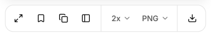

# Toolbar

Use a toolbar to keep related actions together. The gallery shows a
grouped editing toolbar, a floating toolbar for a result card and the
editor toolbar in App chrome.
Available in **GUI**.


## Example

```pascal
unit Docs.Ui.CanvasAndBars.Toolbar;

uses Fpas.Ui.Elements as E;
uses Fpas.Ui.Widgets.Desktop.Toolbars as W;

// Shows a grouped toolbar with a Bold toggle.
// ## Parameters
// - `Bold`: Current Bold toggle state.
// ## Returns
// The toolbar with action proposals.
public function View(Bold: bool): E.Element of W.Event;
begin
  const Items: array of W.Item := [
    W.Item.Group([W.Item.Button(new W.Button(null, 'Undo')),
      W.Item.Button(new W.Button(null, 'Bold', Toggle := Bold))]),
    W.Item.Primary(new W.Button(null, 'Generate'))
  ];
  return W.Toolbar of W.Event('tools', Items, function(Change: W.Event): W.Event => Change,
    new W.Options(Style := 1));
end function;

end unit;
```

## Options and defaults

| Option | Default and meaning |
| --- | --- |
| `Options.Style` | `0` fills the available width. `1` draws raised groups inside a pill. `2` draws a floating pill around the tools. |
| `Options.HideBorder` | `false`. Set it to `true` to hide the bottom line of a plain toolbar. |
| `Options.Enabled` | `true`. Set it to `false` to disable the toolbar and close its overflow menu. |
| `Button.Icon` and `Button.Label` | Supply an icon glyph, a visible label, or both. A null icon and label use the native fallback icon. |
| `Button.Tooltip` and `Button.Shortcut` | Both default to `null`. The tooltip names an icon button. The shortcut displays a key hint in the tooltip. |
| `Button.Toggle` and `Button.Tone` | `null` and `Neutral`. Supply a Boolean for a toggle. The tone colors an ordinary action or an active toggle. |
| `Button.Disabled` and `Button.Flyout` | Both default to `false`. Disable an item or mark its corner to indicate more options. |
| `Item.Primary` | Uses the icon, label, tooltip, shortcut, disabled state and flyout marker. CUI uses the theme's foreground as the fill. |
| `Item.Radio` | Takes up to 32 icons and a zero-based selection. Pass one overflow name per icon, or `null` for unnamed options. |
| `Item.Cycle` | Takes a nonempty array of labels, a zero-based selection and nullable `CycleOptions`. |
| `CycleOptions.Tooltip` and `CycleOptions.Shortcut` | Both default to `null`. The tooltip prefixes the current choice in the overflow menu. The shortcut displays a key hint. |
| `CycleOptions.Disabled`, `CycleOptions.Tone` and `CycleOptions.Flyout` | `false`, `Neutral` and `false`. Disable the picker, color the caption, or show the corner marker. |
| `Item.Group` | Draws a raised well in grouped style. Other styles separate groups with dividers. |
| `Item.Separator` and `Item.Spacer` | Draw a divider or push later tools toward the end. |

## Interaction

CUI moves tools that do not fit into **More tools**. Enter, Space and Down open
the menu when the trigger has focus. CUI reports an overflow selection in the
next frame. Radio choices appear as individual menu entries. Group children
keep their display order. Groups must be at the top level of the toolbar.

Use Tab to move between tools. Use Enter or Space to activate a focused tool.
Use Left and Right to move the selection in a radio set. A cycle advances to
the next label and wraps to the first. A cycle with one label keeps its value.
Bind shortcut keys in the application. Use the activation message to open a flyout.
When drawing directly with `CuiWindow`, call `MarkFlyout()` after a button to
draw the marker on its end-side corner.

`Event.Index` counts actionable items from zero in traversal order, including
children inside groups. Groups, separators and spacers occupy no action index.
`Event.Value` is `0` for momentary actions, `0` or `1` for toggles, or the
proposed zero-based choice index. Update the model with the proposed value.

The overflow uses a button's visible label or its tooltip as the menu name.
Add distinct CUI `##suffix` values when multiple text buttons share a caption.




## See also

- [CUI widget inventory](../../../cui-widget-inventory.md#cui_toolbar)
- [Gallery example](../../../../examples/ui/gui/gallery/Pages/Canvas/View.fpas)
- [App chrome editor](../../../../examples/ui/gui/gallery/Pages/Desktop/Editor.fpas)
- [App chrome](../app-chrome/README.md)
- [Canvas and bars](README.md)

## Source files

- `src/Fpas.Ui/Widgets/Desktop/`
  - [Toolbars.fpas](../../../../src/Fpas.Ui/Widgets/Desktop/Toolbars.fpas)
- `src/Fpas.Ui.Gui/Internal/Widgets/Desktop/`
  - [Toolbar.fpas](../../../../src/Fpas.Ui.Gui/Internal/Widgets/Desktop/Toolbar.fpas)
- `src/Fpas.Ui.Gui.Cui/Interop/Desktop/`
  - [NativeMethods.Toolbar.cs](../../../../src/Fpas.Ui.Gui.Cui/Interop/Desktop/NativeMethods.Toolbar.cs)
- `src/Fpas.Ui.Gui.Cui/Widgets/Desktop/`
  - [CuiWindow.Toolbar.cs](../../../../src/Fpas.Ui.Gui.Cui/Widgets/Desktop/CuiWindow.Toolbar.cs)
- `src/Fpas.Ui.Gui.Cui/native/tests/`
  - [canvas_toolbar.c](../../../../src/Fpas.Ui.Gui.Cui/native/tests/canvas_toolbar.c)
- `src/Fpas.Ui.Gui.Cui/native/widgets/desktop/`
  - [toolbar.c](../../../../src/Fpas.Ui.Gui.Cui/native/widgets/desktop/toolbar.c)
  - [toolbar.h](../../../../src/Fpas.Ui.Gui.Cui/native/widgets/desktop/toolbar.h)
