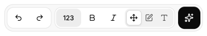
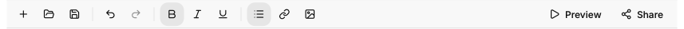

# Toolbar

Use a toolbar to keep related actions together. The gallery shows a
grouped editing toolbar, a floating toolbar for a result card and the
editor toolbar in App chrome.
Available in **GUI**.



## Example

```pascal
unit Docs.Ui.CanvasAndBars.Toolbar;

uses Fpas.Ui.Elements as E;
uses Fpas.Ui.Widgets.Desktop.Toolbars as W;

// Shows a grouped toolbar with a Bold toggle.
// ## Parameters
// - `Bold`: Current Bold toggle state.
// ## Returns
// The toolbar with action proposals.
public function View(Bold: bool): E.Element<W.Event>;
begin
  const Items: array of W.Item := [
    W.Item.Group([W.Item.Button(new W.Button(null, 'Undo')),
      W.Item.Button(new W.Button(null, 'Bold', Toggle := Bold))]),
    W.Item.Primary(new W.Button(null, 'Generate'))
  ];
  return W.Toolbar<W.Event>('tools', Items, function(Change: W.Event): W.Event => Change,
    new W.Options(Style := 1));
end function;

end unit;
```

## Options and defaults

| Option | Default or requirement |
| --- | --- |
| `Style / HideBorder / Enabled` | 0 / false / true. Style 0 is plain, 1 grouped and 2 floating. |
| `Button.Icon / Label / Tooltip / Shortcut` | Supply a glyph or label, an optional tooltip and an optional key hint. |
| `Button.Toggle / Flyout` | null / false. Pass a Boolean for a toggle. Flyout marks a button as having a flyout. |
| `Item.Radio / Cycle` | Radio selects one of the supplied icons. Cycle advances through the labels. |

## Interaction

CUI moves overflowing actions into its more menu. `Event.Index` counts
actionable items in traversal order, including buttons inside groups.
Separators and spacers occupy no action index. Update the model with the
proposed choice or toggle value.




## See also

- [Widget API and types](../../../../src/Fpas.Ui/Widgets/Desktop/Toolbars.fpas)
- [Gallery example](../../../../examples/ui/gui/gallery/Pages/Canvas/View.fpas)
- [App chrome editor](../../../../examples/ui/gui/gallery/Pages/Desktop/Editor.fpas)
- [App chrome](../app-chrome/README.md)
- [Canvas and bars](README.md)

## Source files

- `src/Fpas.Ui.Gui/Internal/Widgets/Desktop/`
  - [Toolbar.fpas](../../../../src/Fpas.Ui.Gui/Internal/Widgets/Desktop/Toolbar.fpas)
- `src/Fpas.Ui.Gui.Cui/Interop/Desktop/`
  - [NativeMethods.Toolbar.cs](../../../../src/Fpas.Ui.Gui.Cui/Interop/Desktop/NativeMethods.Toolbar.cs)
- `src/Fpas.Ui.Gui.Cui/Widgets/Desktop/`
  - [CuiWindow.Toolbar.cs](../../../../src/Fpas.Ui.Gui.Cui/Widgets/Desktop/CuiWindow.Toolbar.cs)
- `src/Fpas.Ui.Gui.Cui/native/widgets/desktop/`
  - [toolbar.c](../../../../src/Fpas.Ui.Gui.Cui/native/widgets/desktop/toolbar.c)
  - [toolbar.h](../../../../src/Fpas.Ui.Gui.Cui/native/widgets/desktop/toolbar.h)
