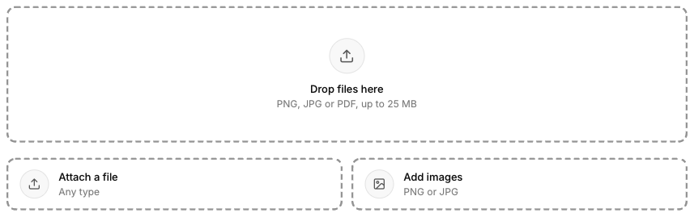

# Dropzone

Use a dropzone to receive files from the desktop. The gallery compares a tall
target for images and PDFs with two compact attachment targets.
Available in **GUI**.



## Example

```pascal
unit Docs.Ui.Capture.Dropzone;

uses Fpas.Ui.Elements as E;
uses Fpas.Ui.Gui.FileDialogs as Dialogs;
uses Fpas.Ui.Mvu.Application as Mvu;
uses Fpas.Ui.Widgets.Files.Dropzones as W;

const Accepted: string := 'png;jpg;jpeg;pdf';

// Messages from the attachment control and file chooser.
public type Msg = variant
  // Receive the accepted files.
  Dropped(Paths: array of string);
  // Request the file chooser.
  Browse;
  // Receive a confirmed selection.
  Selected(Path: string);
end variant;

// Builds the attachments drop target.
// ## Returns
// The dropzone for the application view.
public function View(): E.Element<Msg>;
begin
  return W.Dropzone<Msg>('attachments', Msg.Dropped, function(): Msg => Msg.Browse,
    new W.Options(Description := 'PNG, JPG or PDF', Accept := Accepted));
end function;

// Handles the Browse message.
// ## Returns
// The command to include in the update result.
public function OpenChooser(): Mvu.Command<Msg>;
begin
  return Dialogs.OpenFile<Msg>(Msg.Selected, 'Select an attachment', 'Images and PDF', Accepted);
end function;

end unit;
```

## Options and defaults

| Option | Default or requirement |
| --- | --- |
| `Accept` | Empty accepts any extension. Otherwise separate extensions with semicolons and omit the dots. |
| `Title / Description / Icon` | Empty. Empty title and description use the native text. |
| `Compact / Height / Enabled` | false / 0 / true. Height overrides the default height of the tall target. |
| `OnBrowse` | null. Supply a message factory to handle browse activation. |

## Interaction

CUI picks out accepted files from a desktop drop and sends a detached array
of paths through `OnDrop`. Handle the browse message by returning the chooser
command. Confirming a matching selection sends a message. Cancellation leaves
the model as it was. Check file size and content in the application.

## See also

- [Widget API and types](../../../../src/Fpas.Ui/Widgets/Files/Dropzones.fpas)
- [File chooser command](../../../../src/Fpas.Ui.Gui/FileDialogs.fpas)
- [Gallery example](../../../../examples/ui/gui/gallery/Pages/Capture/View.fpas)
- [Capture](README.md)

## Source files

- `src/Fpas.Ui.Gui/Internal/Widgets/Files/`
  - [Dropzone.fpas](../../../../src/Fpas.Ui.Gui/Internal/Widgets/Files/Dropzone.fpas)
- `src/Fpas.Ui.Gui.Cui/Interop/Files/`
  - [NativeMethods.Dropzone.cs](../../../../src/Fpas.Ui.Gui.Cui/Interop/Files/NativeMethods.Dropzone.cs)
- `src/Fpas.Ui.Gui.Cui/Widgets/Files/`
  - [CuiWindow.Dropzone.Types.cs](../../../../src/Fpas.Ui.Gui.Cui/Widgets/Files/CuiWindow.Dropzone.Types.cs)
  - [CuiWindow.Dropzone.cs](../../../../src/Fpas.Ui.Gui.Cui/Widgets/Files/CuiWindow.Dropzone.cs)
- `src/Fpas.Ui.Gui.Cui/native/widgets/files/`
  - [dropzone.c](../../../../src/Fpas.Ui.Gui.Cui/native/widgets/files/dropzone.c)
  - [dropzone.h](../../../../src/Fpas.Ui.Gui.Cui/native/widgets/files/dropzone.h)
