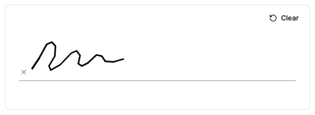

# Signature pad

Use a signature pad to record handwritten strokes. The gallery uses a
520-point-wide pad with a native Clear button. Available in **GUI**.



## Example

```pascal
unit Docs.Ui.Capture.SignaturePad;

uses Fpas.Ui.Elements as E, Fpas.Ui.Widgets.Files.SignaturePads as W;

// Builds a pad that reports a snapshot of the ink.
// ## Returns
// The pad with each signature change as an application message.
public function View(): E.Element<W.Signature>;
begin
  return W.SignaturePad<W.Signature>('signature',
    function(Value: W.Signature): W.Signature => Value,
    new W.Options(Height := 180.0F));
end function;

end unit;
```

## Options and defaults

| Option | Default or requirement |
| --- | --- |
| `Height / Placeholder` | 0 / empty. CUI supplies its default height and instruction. |
| `Ink / Enabled` | null / true. Null uses the theme ink. |
| `OnChange` | null. Supply a mapper to read the detached signature on changes. |

## Interaction

Draw with the mouse or a pen. CUI varies the width with stroke speed and
keeps the ink for the widget's stable ID. Clear removes the ink. Use
`ClearId(Id)` to address the button while it is visible.

The change message contains `Points` in logical drawing coordinates and
`StrokeEnds` as exclusive indices into that array. Save the detached data
in the model if you need it after the pad is removed.

## See also

- [Widget API and types](../../../../src/Fpas.Ui/Widgets/Files/SignaturePads.fpas)
- [Gallery example](../../../../examples/ui/gui/gallery/Pages/Capture/View.fpas)
- [Capture](README.md)

## Source files

- `src/Fpas.Ui.Gui/Internal/Widgets/Files/`
  - [SignaturePad.fpas](../../../../src/Fpas.Ui.Gui/Internal/Widgets/Files/SignaturePad.fpas)
- `src/Fpas.Ui.Gui.Cui/Interop/Files/`
  - [NativeMethods.SignaturePad.cs](../../../../src/Fpas.Ui.Gui.Cui/Interop/Files/NativeMethods.SignaturePad.cs)
- `src/Fpas.Ui.Gui.Cui/Widgets/Files/`
  - [CuiWindow.SignaturePad.Types.cs](../../../../src/Fpas.Ui.Gui.Cui/Widgets/Files/CuiWindow.SignaturePad.Types.cs)
  - [CuiWindow.SignaturePad.cs](../../../../src/Fpas.Ui.Gui.Cui/Widgets/Files/CuiWindow.SignaturePad.cs)
- `src/Fpas.Ui.Gui.Cui/native/widgets/files/`
  - [signature_pad.c](../../../../src/Fpas.Ui.Gui.Cui/native/widgets/files/signature_pad.c)
  - [signature_pad.h](../../../../src/Fpas.Ui.Gui.Cui/native/widgets/files/signature_pad.h)
