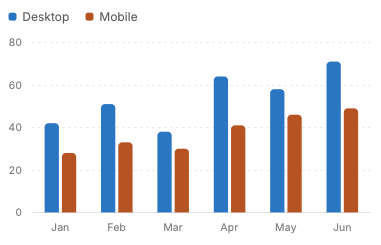

# Bar chart

Use a bar chart to compare amounts in discrete categories. The gallery groups Desktop and Mobile visits and stacks outcomes for its weekly runs.

Available in **GUI**.




## Example

```pascal
unit Docs.Ui.Charts.BarChart;

uses Fpas.Ui.Elements as E;
uses Fpas.Ui.Widgets.Charts.BarCharts as W;
uses Fpas.Ui.Widgets.Charts.Charts as C;

// Builds the bar chart example.
// ## Returns
// The widget for the application view.
public function View(): E.Element of string;
begin
  return W.BarChart of string('visits', [
    new C.Series('Desktop', [42.0F, 51.0F, 38.0F]),
    new C.Series('Mobile', [28.0F, 33.0F, 30.0F])
  ], new C.Options(Labels := ['Jan', 'Feb', 'Mar'], Height := 200.0F));
end function;

end unit;
```

## Options and defaults

| Option | Default or requirement |
| --- | --- |
| `Series` | Supply names and finite values in category order. Series can have different lengths. |
| `Labels` | Empty. Supply category captions in order. CUI uses the array length as the label count. |
| `Stacked` | False. True combines the series in one stack per category. |
| `Width` | Fill. |
| `Height` | Zero, which selects the native plot height of 220 logical units. |
| `Grid` | True. False hides the plot's grid lines. |
| `Legend` | True. CUI shows the legend for two or more series. |
| `Range` | Null. Set increasing value bounds to choose a scale. |
| `Format` | Null. CUI formats axis and hover values automatically. |
| `Annotations` | Empty. Add vertical lines, horizontal thresholds or points. |
| `XMinimum` / `XMaximum` | Zero / zero. Equal bounds use zero-based category indices. Increasing bounds place annotations in your X units. |

## Interaction

Hover to inspect a category. CUI highlights its column and shows each series
value in a compact readout. If the readout cannot fit, CUI shows a tooltip.
The chart sends no selection message.

Category labels can cover only part of the data. CUI leaves the other axis
positions unlabeled and uses their one-based indices in the hover readout.
Use [chart colors and annotations](README.md#annotations) to style series and marks.

If you set `Range`, choose bounds that enclose each bar, including intermediate
values in a stack. CUI can draw beyond the plot when a bar exceeds the bounds.

## See also

- [CUI widget inventory](../../../cui-widget-inventory.md#cui_line_chart)
- [Widget API and types](../../../../src/Fpas.Ui/Widgets/Charts/BarCharts.fpas)
- [Gallery example](../../../../examples/ui/gui/gallery/Pages/Charts/View.fpas)
- [Shared chart types](../../../../src/Fpas.Ui/Widgets/Charts/Charts.fpas)
- [Line chart](line-chart.md)
- [Charts](README.md)

## Source files

- [BarChart.fpas](../../../../src/Fpas.Ui.Gui/Internal/Widgets/Charts/BarChart.fpas)
- [CuiWindow.BarChart.cs](../../../../src/Fpas.Ui.Gui.Cui/Widgets/Charts/CuiWindow.BarChart.cs)
- [bar_chart.c](../../../../src/Fpas.Ui.Gui.Cui/native/widgets/charts/bar_chart.c)
- [bar_chart.h](../../../../src/Fpas.Ui.Gui.Cui/native/widgets/charts/bar_chart.h)
