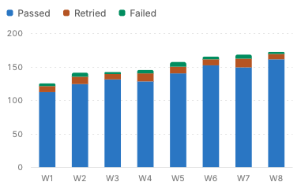

# Bar chart

Use a bar chart to compare amounts in discrete categories. The gallery groups Desktop and Mobile visits and stacks outcomes for its weekly runs.

Available in **GUI**.




## Example

```pascal
unit Docs.Ui.Charts.BarChart;

uses Fpas.Ui.Elements as E, Fpas.Ui.Widgets.Charts.BarCharts as W,
  Fpas.Ui.Widgets.Charts.Charts as C;

// Builds the bar chart example.
// ## Returns
// The widget for the application view.
public function View(): E.Element<string>;
begin
  return W.BarChart<string>('visits', [
    new C.Series('Desktop', [42.0F, 51.0F, 38.0F]),
    new C.Series('Mobile', [28.0F, 33.0F, 30.0F])
  ], new C.Options(Labels := ['Jan', 'Feb', 'Mar'], Height := 200.0F));
end function;

end unit;
```

## Options and defaults

| Option | Default or requirement |
| --- | --- |
| `Series / Labels` | Supply finite values in category order. Labels optionally name the categories. |
| `Stacked` | false. CUI groups series side by side. Enable to combine them in a single stack per category. |
| `Width / Height` | Fill / 0. Zero uses the native height. |
| `Grid / Legend` | true / true. |
| `Range / Format / Annotations` | null / null / empty. Supply a fixed increasing range, number format or annotation list as needed. |

## Interaction

Hover to inspect a category and see its native readout. CUI lays out the bars and legend from the supplied data. Use series names as legend labels.

## See also

- [Widget API and types](../../../../src/Fpas.Ui/Widgets/Charts/BarCharts.fpas)
- [Gallery example](../../../../examples/ui/gui/gallery/Pages/Charts/View.fpas)
- [Shared chart types](../../../../src/Fpas.Ui/Widgets/Charts/Charts.fpas)
- [Line chart](line-chart.md)
- [Charts](README.md)

## Source files

- [BarChart.fpas](../../../../src/Fpas.Ui.Gui/Internal/Widgets/Charts/BarChart.fpas)
- [CuiWindow.BarChart.cs](../../../../src/Fpas.Ui.Gui.Cui/Widgets/Charts/CuiWindow.BarChart.cs)
- [bar_chart.c](../../../../src/Fpas.Ui.Gui.Cui/native/widgets/charts/bar_chart.c)
- [bar_chart.h](../../../../src/Fpas.Ui.Gui.Cui/native/widgets/charts/bar_chart.h)
