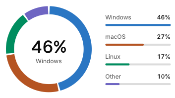

# Donut chart

Use a donut to show a small set of shares as parts of a total.

Available in **GUI**.



## Example

```pascal
unit Docs.Ui.Charts.DonutChart;

uses Fpas.Ui.Elements as E, Fpas.Ui.Widgets.Charts.DonutCharts as W,
  Fpas.Ui.Widgets.Charts.Charts as C;

// Builds the donut chart example.
// ## Returns
// The widget for the application view.
public function View(): E.Element<string>;
begin
  return W.DonutChart<string>('platforms', [46.0F, 27.0F, 17.0F, 10.0F],
    ['Windows', 'macOS', 'Linux', 'Other'],
    new W.Options(Height := 180.0F, Format := new C.ValueFormat(Suffix := '%')));
end function;

end unit;
```

## Options and defaults

| Option | Default or requirement |
| --- | --- |
| `Values` | Finite nonnegative shares with a finite sum. |
| `Labels` | An empty array or one literal label per share. |
| `Width / Height` | Content / 0. Zero uses the native height. |
| `Legend / Format` | true / null. A null format uses native formatting. |

## Interaction

CUI sizes the chart to the available space and draws wedges proportional to
the shares. Hover a wedge to show its value in the center. At rest, the center
shows the total, or the largest share when the format includes a percent sign.
For a percent suffix, pass values already expressed in percent.

## See also

- [Widget API and types](../../../../src/Fpas.Ui/Widgets/Charts/DonutCharts.fpas)
- [Gallery example](../../../../examples/ui/gui/gallery/Pages/Charts/View.fpas)
- [Split bar](../more-charts/split-bar.md)
- [Charts](README.md)

## Source files

- [DonutChart.fpas](../../../../src/Fpas.Ui.Gui/Internal/Widgets/Charts/DonutChart.fpas)
- [CuiWindow.DonutChart.cs](../../../../src/Fpas.Ui.Gui.Cui/Widgets/Charts/CuiWindow.DonutChart.cs)
- [donut_chart.c](../../../../src/Fpas.Ui.Gui.Cui/native/widgets/charts/donut_chart.c)
- [donut_chart.h](../../../../src/Fpas.Ui.Gui.Cui/native/widgets/charts/donut_chart.h)
