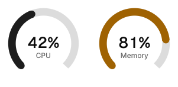

# Gauge

Use a gauge for a single reading on a normalized scale. The gallery shows CPU and memory utilization.

Available in **GUI**.



## Example

```pascal
unit Docs.Ui.Charts.Gauge;

uses Fpas.Ui.Elements as E, Fpas.Ui.Widgets.Charts.Gauges as W;

// Builds the gauge example.
// ## Parameters
// - `Fraction`: Current reading from zero through one.
// ## Returns
// The widget for the application view.
public function View(Fraction: float): E.Element<string>;
begin
  return W.Gauge<string>('cpu', 'CPU', Fraction, 130.0F);
end function;

end unit;
```

## Options and defaults

| Option | Default or requirement |
| --- | --- |
| `Label` | Literal caption. |
| `Value` | A finite fraction from 0 through 1. |
| `Size` | 0 uses CUI's 140-point diameter. Supply a logical size when a smaller gauge is needed. |

## Interaction

Pass the current model reading. CUI draws and animates the gauge as it changes. Use a radial gauge when you need a scale in physical units, threshold bands or a target marker.

## See also

- [Widget API and types](../../../../src/Fpas.Ui/Widgets/Charts/Gauges.fpas)
- [Gallery example](../../../../examples/ui/gui/gallery/Pages/Charts/View.fpas)
- [Radial gauge](../more-charts/radial-gauge.md)
- [Progress ring](../feedback/progress-ring.md)
- [Charts](README.md)
