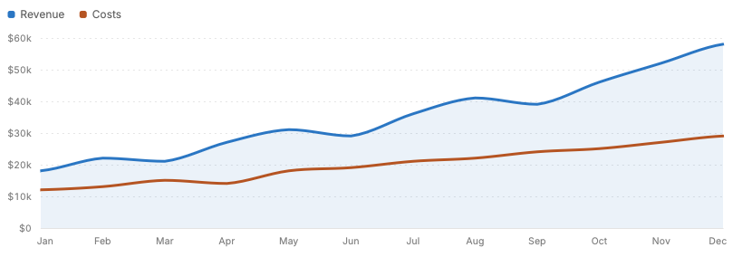

# Line chart

Use a line chart to show how one or more series change across ordered samples. The gallery shows smoothed revenue and cost areas and a separate stacked, dithered request chart.

Available in **GUI**.




## Example

```pascal
unit Docs.Ui.Charts.LineChart;

uses Fpas.Ui.Elements as E;
uses Fpas.Ui.Widgets.Charts.Charts as C;
uses Fpas.Ui.Widgets.Charts.LineCharts as W;

// Builds the line chart example.
// ## Returns
// The widget for the application view.
public function View(): E.Element of string;
begin
  return W.LineChart of string('revenue', [
    new C.Series('Revenue', [18.0F, 22.0F, 21.0F, 27.0F]),
    new C.Series('Costs', [12.0F, 13.0F, 15.0F, 14.0F])
  ], new C.Options(Labels := ['Jan', 'Feb', 'Mar', 'Apr'], Area := true, Smooth := true,
    Height := 240.0F, Format := new C.ValueFormat(Prefix := '$', Suffix := 'k')));
end function;

end unit;
```

## Options and defaults

| Option | Default or requirement |
| --- | --- |
| `Series / Labels` | Supply finite values in sample order. Labels optionally name the sample positions. |
| `Width / Height` | Fill / 0. Zero uses CUI's default height. |
| `Area / Smooth / Dither / Stacked` | All false. Dither gives the area a dot pattern. Stacked combines the series in display order. |
| `Grid / Legend` | true / true. |
| `Range / Format / Annotations` | null / null / empty. The range and number format default to native automatic values. |

## Interaction

Move the pointer across the chart to inspect values using its native crosshair. The chart does not send a selection message. Annotations can mark a threshold or a point with labels and detail text. X positions use zero-based sample indices.

## See also

- [CUI widget inventory](../../../cui-widget-inventory.md#cui_line_chart)
- [Widget API and types](../../../../src/Fpas.Ui/Widgets/Charts/LineCharts.fpas)
- [Gallery example](../../../../examples/ui/gui/gallery/Pages/Charts/View.fpas)
- [Shared chart types](../../../../src/Fpas.Ui/Widgets/Charts/Charts.fpas)
- [Bar chart](bar-chart.md)
- [Charts](README.md)

## Source files

- [LineChart.fpas](../../../../src/Fpas.Ui.Gui/Internal/Widgets/Charts/LineChart.fpas)
- [CuiWindow.LineChart.cs](../../../../src/Fpas.Ui.Gui.Cui/Widgets/Charts/CuiWindow.LineChart.cs)
- [line_chart.c](../../../../src/Fpas.Ui.Gui.Cui/native/widgets/charts/line_chart.c)
- [line_chart.h](../../../../src/Fpas.Ui.Gui.Cui/native/widgets/charts/line_chart.h)
