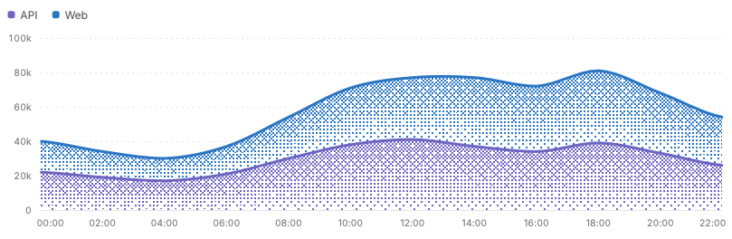

# Line chart

Use a line chart to show how one or more series change across ordered samples. The gallery shows smoothed revenue and cost areas and a separate stacked, dithered request chart.

Available in **GUI**.




## Example

```pascal
unit Docs.Ui.Charts.LineChart;

uses Fpas.Ui.Elements as E;
uses Fpas.Ui.Widgets.Charts.Charts as C;
uses Fpas.Ui.Widgets.Charts.LineCharts as W;

// Builds the line chart example.
// ## Returns
// The widget for the application view.
public function View(): E.Element of string;
begin
  return W.LineChart of string('revenue', [
    new C.Series('Revenue', [18.0F, 22.0F, 21.0F, 27.0F]),
    new C.Series('Costs', [12.0F, 13.0F, 15.0F, 14.0F])
  ], new C.Options(Labels := ['Jan', 'Feb', 'Mar', 'Apr'], Area := true, Smooth := true,
    Height := 240.0F, Format := new C.ValueFormat(Prefix := '$', Suffix := 'k')));
end function;

end unit;
```

## Options and defaults

| Option | Default or requirement |
| --- | --- |
| `Series` | Supply a name and finite samples for each series. The default color follows series order. Choose a theme color or an explicit color to override it. |
| `Labels` | Empty. Add x-axis labels in sample order. The hover readout uses a one-based sample number when a label is absent. |
| `Width / Height` | Fill / 0. Zero sets a 220-unit plot height. |
| `Area` | false. Fill under the first series with a solid tint. |
| `Smooth` | false. Draw curves through series with at least three samples. |
| `Dither` | false. Fill under every series with dots that thin out toward the bottom of its band. |
| `Stacked` | false. Draw each series on top of the preceding series. |
| `Grid / Legend` | true / true. Grid controls the lines behind the data. A legend appears when there is more than one series. |
| `Range / Format` | null / null. CUI chooses the value-axis bounds and number format. `Format` applies to the value axis and the hover readout. |
| `Annotations` | Empty. Supply reference lines or points with optional labels, detail text and color. |
| `XMinimum / XMaximum` | 0 / 0. Equal bounds use zero-based sample indices. Increasing bounds set the coordinates of the first and last samples for the annotations. |

## Interaction

Move the pointer over the plot to inspect the nearest sample. The native
crosshair glides between samples. The GUI inspection snapshot reports hover
over the plot. The chart is read-only.

Annotations can use the theme accent or an explicit color. The explicit color
takes precedence. Set `XMinimum` and `XMaximum` to position vertical lines and
points using your own units. Samples stay evenly spaced.

## See also

- [CUI widget inventory](../../../cui-widget-inventory.md#cui_line_chart)
- [Widget API and types](../../../../src/Fpas.Ui/Widgets/Charts/LineCharts.fpas)
- [Gallery example](../../../../examples/ui/gui/gallery/Pages/Charts/View.fpas)
- [Shared chart types](../../../../src/Fpas.Ui/Widgets/Charts/Charts.fpas)
- [Bar chart](bar-chart.md)
- [Charts](README.md)

## Source files

- [LineChart.fpas](../../../../src/Fpas.Ui.Gui/Internal/Widgets/Charts/LineChart.fpas)
- [CuiWindow.LineChart.cs](../../../../src/Fpas.Ui.Gui.Cui/Widgets/Charts/CuiWindow.LineChart.cs)
- [line_chart.c](../../../../src/Fpas.Ui.Gui.Cui/native/widgets/charts/line_chart.c)
- [line_chart.h](../../../../src/Fpas.Ui.Gui.Cui/native/widgets/charts/line_chart.h)
