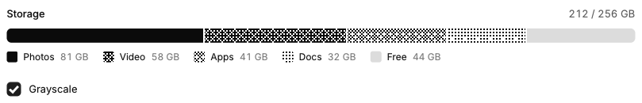

# Pattern meter

Use a pattern meter to show capacity split between categories. The gallery shows used and free storage and can switch the bar to grayscale.

Available in **GUI**.




## Example

```pascal
unit Docs.Ui.Charts.PatternMeter;

uses Fpas.Ui.Elements as E;
uses Fpas.Ui.Widgets.Charts.PatternMeters as W;

// Builds the pattern meter example.
// ## Parameters
// - `Grayscale`: Whether to draw the parts as grayscale patterns.
// ## Returns
// The widget for the application view.
public function View(Grayscale: bool): E.Element of string;
begin
  return W.PatternMeter of string('storage', [
    new W.Part('Photos', 81.0F), new W.Part('Video', 58.0F),
    new W.Part('Apps', 41.0F), new W.Part('Docs', 32.0F)
  ], new W.Options(Total := 256.0F, Label := 'Storage', Unit := 'GB', Grayscale := Grayscale));
end function;

end unit;
```

## Options and defaults

| Option | Default or requirement |
| --- | --- |
| `Parts` | Up to 32 parts with nonnegative amounts and a finite sum. Each name is literal text. |
| `Part.Color` | Automatic uses the theme's series palette. An explicit color or palette slot overrides it. |
| `Part.Density` | Zero uses CUI's sequence of 1, 0.66, 0.42, 0.24, 0.14 and 0.08. Later parts use 0.08. Pass a fraction greater than zero to set the density. |
| `Total` | Zero uses the sum. A larger capacity leaves unused space in the track. If the sum exceeds capacity, the bar uses the sum as its scale. |
| `Label` | Empty omits the title. A title is literal text. |
| `Unit` | Empty omits the suffix. A unit follows the amount with a space. |
| `Format` | Null uses native `%g` number formatting. Supply `Charts.ValueFormat` to set decimal places and literal prefix or suffix text. |
| `FreeLabel` | Null uses Free. An empty string omits the free-space legend entry. |
| `Grayscale` | False. True uses the foreground color for all parts. |
| `Legend` | True. False hides all legend entries. |
| `Width` | Fill. Fixed and Percent specify a width. Content also uses the native fill width. |
| `Height` | Zero uses the native bar height of 18 logical units. |
| `Enabled` | True. False disables pointer and keyboard inspection. |

## Interaction

Hover a part or its legend entry to inspect it. Tab focuses the bar.
Use Left or Right to move between parts. Home and End select the first and
last part. Escape clears the keyboard selection. CUI owns the inspection
state. The GUI snapshot reports the shown zero-based index, or minus one.

## See also

- [CUI widget inventory](../../../cui-widget-inventory.md#cui_pattern_meter)
- [Widget API and types](../../../../src/Fpas.Ui/Widgets/Charts/PatternMeters.fpas)
- [Gallery example](../../../../examples/ui/gui/gallery/Pages/Charts/View.fpas)
- [Meter](../feedback/meter.md)
- [Charts](README.md)

## Source files

- [PatternMeter.fpas](../../../../src/Fpas.Ui.Gui/Internal/Widgets/Charts/PatternMeter.fpas)
- [CuiWindow.PatternMeter.cs](../../../../src/Fpas.Ui.Gui.Cui/Widgets/Charts/CuiWindow.PatternMeter.cs)
- [pattern_meter.c](../../../../src/Fpas.Ui.Gui.Cui/native/widgets/charts/pattern_meter.c)
- [pattern_meter.h](../../../../src/Fpas.Ui.Gui.Cui/native/widgets/charts/pattern_meter.h)
