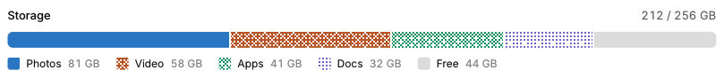

# Pattern meter

Use a pattern meter to show capacity split between categories. The gallery shows used and free storage and can switch the bar to grayscale.

Available in **GUI**.




## Example

```pascal
unit Docs.Ui.Charts.PatternMeter;

uses Fpas.Ui.Elements as E;
uses Fpas.Ui.Widgets.Charts.PatternMeters as W;

// Builds the pattern meter example.
// ## Parameters
// - `Grayscale`: Whether to draw the parts as grayscale patterns.
// ## Returns
// The widget for the application view.
public function View(Grayscale: bool): E.Element<string>;
begin
  return W.PatternMeter<string>('storage', [
    new W.Part('Photos', 81.0F), new W.Part('Video', 58.0F),
    new W.Part('Apps', 41.0F), new W.Part('Docs', 32.0F)
  ], new W.Options(Total := 256.0F, Label := 'Storage', Unit := 'GB', Grayscale := Grayscale));
end function;

end unit;
```

## Options and defaults

| Option | Default or requirement |
| --- | --- |
| `Parts` | Up to 32 named nonnegative amounts with a finite sum. Color defaults to Automatic. Density 0 uses CUI's sequence. |
| `Total / FreeLabel` | 0 uses the sum. A positive capacity can show unused space. null uses CUI's free label and an empty string hides it in the legend. |
| `Label / Unit / Format` | Empty / empty / null. A null format uses native numeric formatting. |
| `Grayscale / Legend / Enabled` | false / true / true. Grayscale distinguishes the parts using dot density. |
| `Width / Height` | Fill / 0. Zero uses the native 18-point bar height. |

## Interaction

Hover a part or its legend entry to inspect it. Tab focuses the bar. Arrow keys, Home, End and Escape select or clear a part. CUI owns this inspection state. The GUI snapshot reports the selected index, or minus one.

## See also

- [Widget API and types](../../../../src/Fpas.Ui/Widgets/Charts/PatternMeters.fpas)
- [Gallery example](../../../../examples/ui/gui/gallery/Pages/Charts/View.fpas)
- [Meter](../feedback/meter.md)
- [Charts](README.md)

## Source files

- [PatternMeter.fpas](../../../../src/Fpas.Ui.Gui/Internal/Widgets/Charts/PatternMeter.fpas)
- [CuiWindow.PatternMeter.cs](../../../../src/Fpas.Ui.Gui.Cui/Widgets/Charts/CuiWindow.PatternMeter.cs)
- [pattern_meter.c](../../../../src/Fpas.Ui.Gui.Cui/native/widgets/charts/pattern_meter.c)
- [pattern_meter.h](../../../../src/Fpas.Ui.Gui.Cui/native/widgets/charts/pattern_meter.h)
