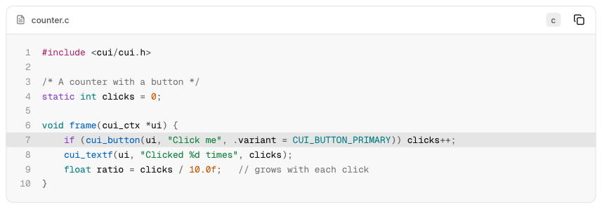
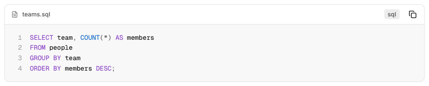

# Code block

Use a code block for read-only source with highlighting and a native copy
button. The gallery includes C, Python, shell and SQL. Available in **GUI**.



## Example

```pascal
unit Docs.Ui.Code.CodeBlock;

uses Fpas.Ui.Elements as E, Fpas.Ui.Widgets.Developer.CodeBlocks as W;

// Displays the current SQL query.
// ## Parameters
// - `Query`: SQL source text.
// ## Returns
// A code block with line numbers and a copy button.
public function View(Query: string): E.Element<string>;
begin
  return W.CodeBlock<string>('query', Query,
    new W.Options(Language := 'sql', Title := 'people.sql', LineNumbers := true));
end function;

end unit;
```

## Options and defaults

| Option | Default or requirement |
| --- | --- |
| `Language / Title` | Both empty. Empty Language draws plain text. |
| `LineNumbers / HighlightFrom / HighlightTo` | false / 0 / 0. Set HighlightFrom to a one-based line. Use zero HighlightTo to highlight just that line. |
| `MaxHeight / Size` | Both zero. Zero means unlimited height or the native font size. |
| `NoHeader` | false. Set true to hide the header and copy button. |

## Interaction

The header button copies the source text. CUI scrolls code that exceeds the
available viewport.



## See also

- [Widget API and types](../../../../src/Fpas.Ui/Widgets/Developer/CodeBlocks.fpas)
- [Gallery example](../../../../examples/ui/gui/gallery/Pages/Code/View.fpas)
- [Code editor](code-editor.md)
- [Code](README.md)
