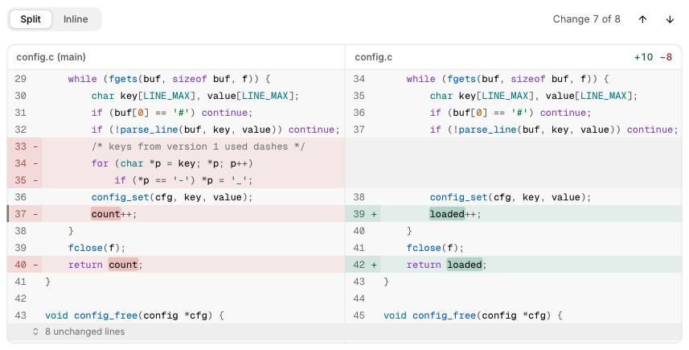
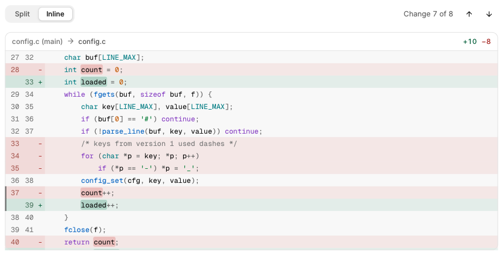

# Diff viewer

Use a diff viewer to compare two source strings. The gallery shows
changes to a C configuration loader in split and inline form.
Available in **GUI**.



## Example

```pascal
unit Docs.Ui.Code.DiffViewer;

uses Fpas.Ui.Elements as E;
uses Fpas.Ui.Widgets.Developer.DiffViews as W;

// Compares two versions of a file.
// ## Parameters
// - `Before`: Previous source.
// - `After`: Updated source.
// - `Current`: Selected change index, or minus one.
// ## Returns
// The diff with the native selection and layout as messages.
public function View(Before: string; After: string; Current: int): E.Element of W.Event;
begin
  return W.DiffView of W.Event('config-diff', Before, After, Current,
    function(Change: W.Event): W.Event => Change,
    new W.Options(Height := 372.0F, Language := 'c',
      OldTitle := 'Before', NewTitle := 'After'));
end function;

end unit;
```

## Options and defaults

| Option | Default or requirement |
| --- | --- |
| `Language / OldTitle / NewTitle` | text / empty / empty. |
| `Inline / Context / Fold` | false / 3 / true. Context counts the unchanged lines retained beside changes. |
| `SplitMinimumWidth` | Zero uses 560 logical units. Below this width, the viewer switches to inline layout. |
| `IgnoreLineEndings` | false. Set true to ignore differing line terminators. |
| `Width / Height / Size` | Fill / 0 / 0. Zero uses native height or font size. A height of minus one fills the viewport. |

## Interaction

Keep the selected change in the model. Update it from `Current` in the
proposal or from your own previous and next controls. CUI can show an
inline diff when the viewport is narrow. Read `Event.Inline` for the
actual layout and `Count` for the number of change blocks.
`Added` and `Removed` count changed lines. `Folds` counts folded rows, and
`Hidden` counts the unchanged lines in those rows. `CurrentChanged` reports
selection movement. `Recomputed` reports a new diff. `Approximate` indicates
that CUI reached its search limit and may group changes more broadly.



## Inspect displayed rows

Return `Fpas.Ui.Gui.DiffGeometry.ReadRows of TMsg(Id, First, Capacity, OnRead)`
from `Update` after the first presentation. `First` is a zero-based displayed
row index. Use zero capacity to read the total alone. The callback receives
a detached page and the total row count after layout and folding.

Each row gives its kind, zero-based old and new line numbers,
change index and number of lines hidden by a fold. A missing line or
change uses minus one. Split layout can pair changed lines in one row.
Inline layout reports additions and removals separately.
An absent diff viewer returns an empty page with a total of zero.

When drawing directly with CUI, call `CuiWindow.ReadDiffRows(Id, First, Capacity)`
between frames.

## See also

- [CUI widget inventory](../../../cui-widget-inventory.md#cui_diff_view)
- [Widget API and types](../../../../src/Fpas.Ui/Widgets/Developer/DiffViews.fpas)
- [Gallery example](../../../../examples/ui/gui/gallery/Pages/Code/Tools.fpas)
- [Code](README.md)

## Source files

- [FPAS row queries](../../../../src/Fpas.Ui.Gui/DiffGeometry.fpas)

- `src/Fpas.Ui.Gui/Internal/Widgets/Developer/`
  - [DiffView.fpas](../../../../src/Fpas.Ui.Gui/Internal/Widgets/Developer/DiffView.fpas)
- `src/Fpas.Ui.Gui.Cui/Interop/Developer/`
  - [NativeMethods.DiffView.cs](../../../../src/Fpas.Ui.Gui.Cui/Interop/Developer/NativeMethods.DiffView.cs)
- `src/Fpas.Ui.Gui.Cui/Widgets/Developer/`
  - [CuiWindow.DiffView.Types.cs](../../../../src/Fpas.Ui.Gui.Cui/Widgets/Developer/CuiWindow.DiffView.Types.cs)
  - [CuiWindow.DiffView.cs](../../../../src/Fpas.Ui.Gui.Cui/Widgets/Developer/CuiWindow.DiffView.cs)
- `src/Fpas.Ui.Gui.Cui/native/widgets/developer/`
  - [diff_view.c](../../../../src/Fpas.Ui.Gui.Cui/native/widgets/developer/diff_view.c)
  - [diff_view.h](../../../../src/Fpas.Ui.Gui.Cui/native/widgets/developer/diff_view.h)
