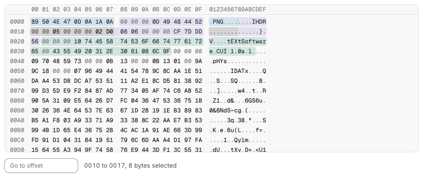

# Hex viewer

Use a hex viewer to inspect byte offsets and ranges. The gallery marks
chunks of a PNG, supports byte overwrite and provides a Go to offset field.
Available in **GUI**.



## Example

```pascal
unit Docs.Ui.Code.HexViewer;

uses Fpas.Ui.Elements as E;
uses Fpas.Ui.Styles as S;
uses Fpas.Ui.Widgets.Developer.HexViews as W;

// Displays an editable PNG byte buffer.
// ## Parameters
// - `Bytes`: Current immutable buffer.
// - `Selected`: Model-owned range and caret.
// ## Returns
// Hex viewer with selection and edit proposals.
public function View(Bytes: array of byte; Selected: W.Selection): E.Element of W.Event;
begin
  return W.HexView of W.Event('png-bytes', Bytes, Selected,
    function(Change: W.Event): W.Event => Change,
    new W.Options(Editable := true,
      Marks := [new W.Mark(0, 8, S.Tone.Info, 'PNG signature')]));
end function;

end unit;
```

## Options and defaults

| Option | Default or requirement |
| --- | --- |
| `Marks / BaseAddress / BytesPerRow` | Empty / 0 / 16. Choose 8, 16 or 32 as the preferred row size. BaseAddress changes the display address of byte zero. |
| `GoTo / Editable` | Minus one / false. Pass a byte offset for a one-shot reveal. |
| `ShowAscii / ShowHeader` | Both true. |
| `Width / Height / Size` | Fill / 0 / 0. Zero uses native height or font size. A height of minus one fills the viewport. |

## Interaction

Store `Event.Selected` to accept a new range or caret. Offsets index the
buffer from zero. When `Event.Data` contains replacement bytes, store that
buffer and use `EditOffset` and `EditLength` to identify the overwrite.
Reset a GoTo request to minus one after handling its proposal.

## See also

- [Widget API and types](../../../../src/Fpas.Ui/Widgets/Developer/HexViews.fpas)
- [Gallery example](../../../../examples/ui/gui/gallery/Pages/Code/Tools.fpas)
- [Code](README.md)

## Source files

- `src/Fpas.Ui.Gui/Internal/Widgets/Developer/`
  - [HexView.fpas](../../../../src/Fpas.Ui.Gui/Internal/Widgets/Developer/HexView.fpas)
- `src/Fpas.Ui.Gui.Cui/Interop/Developer/`
  - [NativeMethods.HexView.cs](../../../../src/Fpas.Ui.Gui.Cui/Interop/Developer/NativeMethods.HexView.cs)
- `src/Fpas.Ui.Gui.Cui/Widgets/Developer/`
  - [CuiWindow.HexView.Types.cs](../../../../src/Fpas.Ui.Gui.Cui/Widgets/Developer/CuiWindow.HexView.Types.cs)
  - [CuiWindow.HexView.cs](../../../../src/Fpas.Ui.Gui.Cui/Widgets/Developer/CuiWindow.HexView.cs)
- `src/Fpas.Ui.Gui.Cui/native/widgets/developer/`
  - [hex_view.c](../../../../src/Fpas.Ui.Gui.Cui/native/widgets/developer/hex_view.c)
  - [hex_view.h](../../../../src/Fpas.Ui.Gui.Cui/native/widgets/developer/hex_view.h)
