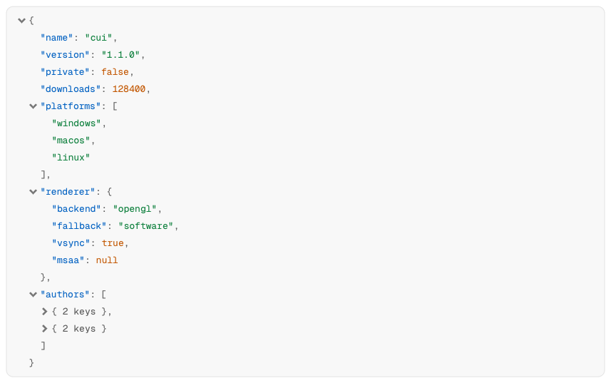
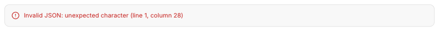

# JSON viewer

Use a JSON viewer to inspect a document. The gallery shows an expandable
object and a separate example with a parse error. Available in **GUI**.



## Example

```pascal
unit Docs.Ui.Code.JsonViewer;

uses Fpas.Ui.Elements as E, Fpas.Ui.Widgets.Developer.JsonViews as W;

// Displays the current JSON document.
// ## Parameters
// - `Document`: Literal JSON source.
// ## Returns
// The native JSON viewer for the application view.
public function View(Document: string): E.Element<string>;
begin
  return W.JsonView<string>('response', Document, new W.Options(ExpandDepth := 2));
end function;

end unit;
```

## Options and defaults

| Option | Default or requirement |
| --- | --- |
| `Json` | Pass source text. CUI parses the document and displays errors in place. |
| `ExpandDepth / MaxHeight` | Both zero. Zero uses the native initial expansion or leaves the height unlimited. |

## Interaction

Click an object or array brace to fold or unfold it. Folded containers show
the number of items. CUI keeps that expansion state for the mounted widget.



## See also

- [Widget API and types](../../../../src/Fpas.Ui/Widgets/Developer/JsonViews.fpas)
- [Gallery example](../../../../examples/ui/gui/gallery/Pages/Code/View.fpas)
- [Code](README.md)

## Source files

- `src/Fpas.Ui.Gui/Internal/Widgets/Developer/`
  - [JsonView.fpas](../../../../src/Fpas.Ui.Gui/Internal/Widgets/Developer/JsonView.fpas)
- `src/Fpas.Ui.Gui.Cui/Interop/Developer/`
  - [NativeMethods.JsonView.cs](../../../../src/Fpas.Ui.Gui.Cui/Interop/Developer/NativeMethods.JsonView.cs)
- `src/Fpas.Ui.Gui.Cui/Widgets/Developer/`
  - [CuiWindow.JsonView.cs](../../../../src/Fpas.Ui.Gui.Cui/Widgets/Developer/CuiWindow.JsonView.cs)
- `src/Fpas.Ui.Gui.Cui/native/widgets/developer/`
  - [json_view.c](../../../../src/Fpas.Ui.Gui.Cui/native/widgets/developer/json_view.c)
  - [json_view.h](../../../../src/Fpas.Ui.Gui.Cui/native/widgets/developer/json_view.h)
