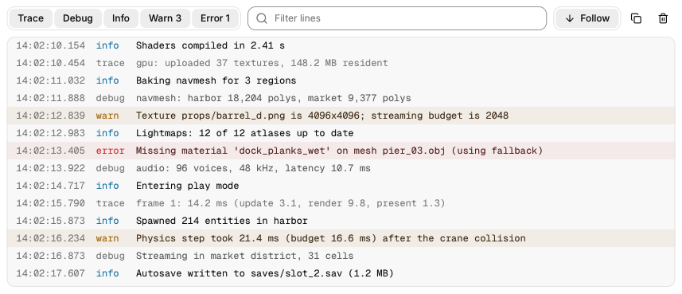

# Log console

Use a log console to inspect a stream of messages by severity or search
text. The gallery shows a timestamped build log with warnings and errors.
Available in **GUI** and [TUI](../../tui/developer/log-console.md).



## Example

```pascal
unit Docs.Ui.Code.LogConsole;

uses Fpas.Ui.Elements as E, Fpas.Ui.Widgets.Developer.LogConsoles as W;

// Displays build output.
// ## Parameters
// - `Entries`: Immutable log entries in arrival order.
// ## Returns
// The console with a message to clear the model.
public function View(Entries: array of W.Entry): E.Element<string>;
begin
  return W.LogConsole<string>('build-log', Entries, 'clear-build-log',
    new W.Options(Height := 352.0F, Timestamps := true));
end function;

end unit;
```

## Options and defaults

| Option | Default or requirement |
| --- | --- |
| `Entry.Severity / Time / Text` | Supply Trace, Debug, Info, Warning or Error, a timestamp in seconds and the message text. |
| `Timestamps / Toolbar` | false / true. |
| `Width / Height / Size` | Fill / 0 / 0. Zero uses native height or font size. A height of minus one fills the viewport. |

## Interaction

CUI handles filtering, copying and follow mode. The Clear button sends
the message supplied to `LogConsole`. Clear the entries in your update to
apply it. Pass new entries as output arrives.

## See also

- [Widget API and types](../../../../src/Fpas.Ui/Widgets/Developer/LogConsoles.fpas)
- [Gallery example](../../../../examples/ui/gui/gallery/Pages/Code/Tools.fpas)
- [Terminal](../files/terminal.md)
- [Code](README.md)

## Source files

- `src/Fpas.Ui.Gui/Internal/Widgets/Developer/`
  - [LogConsole.fpas](../../../../src/Fpas.Ui.Gui/Internal/Widgets/Developer/LogConsole.fpas)
- `src/Fpas.Ui.Gui.Cui/Interop/Developer/`
  - [NativeMethods.LogConsole.cs](../../../../src/Fpas.Ui.Gui.Cui/Interop/Developer/NativeMethods.LogConsole.cs)
- `src/Fpas.Ui.Gui.Cui/Widgets/Developer/`
  - [CuiWindow.LogConsole.Types.cs](../../../../src/Fpas.Ui.Gui.Cui/Widgets/Developer/CuiWindow.LogConsole.Types.cs)
  - [CuiWindow.LogConsole.cs](../../../../src/Fpas.Ui.Gui.Cui/Widgets/Developer/CuiWindow.LogConsole.cs)
- `src/Fpas.Ui.Gui.Cui/native/widgets/developer/`
  - [log_console.c](../../../../src/Fpas.Ui.Gui.Cui/native/widgets/developer/log_console.c)
  - [log_console.h](../../../../src/Fpas.Ui.Gui.Cui/native/widgets/developer/log_console.h)

- [Shared build log entries](../../../../examples/ui/gui/gallery/Shared/BuildLog.fpas)
