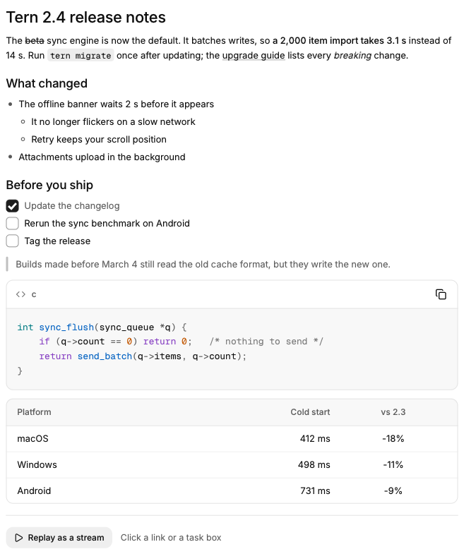

# Markdown

Use Markdown to display formatted notes with links and task lists. The
gallery can replay its release notes as a stream. Available in **GUI**.



## Example

```pascal
unit Docs.Ui.Code.Markdown;

uses Fpas.Ui.Elements as E;
uses Fpas.Ui.Widgets.Display.Markdowns as W;

// Renders release notes or a partial update to them.
// ## Parameters
// - `Text`: Markdown source received so far.
// - `Streaming`: Whether the document is still arriving.
// ## Returns
// Markdown with link and task events as messages.
public function View(Text: string; Streaming: bool): E.Element of W.Event;
begin
  return W.Markdown of W.Event('notes', Text, function(Change: W.Event): W.Event => Change,
    new W.Options(Streaming := Streaming));
end function;

end unit;
```

## Options and defaults

| Option | Default or requirement |
| --- | --- |
| `Width / Size` | Fill / 0. Zero uses the theme body size. |
| `Color` | Null uses theme colors. An RGBA color with nonzero alpha applies to body text and links. |
| `Compact / Streaming` | Both false. Compact reduces heading sizes and spacing. Set Streaming while supplying incomplete text. |

## Interaction

`Event.Link` reports the activated URL. `Event.Hover` reports a URL or null
when the pointer leaves the link. `Event.Task` reports the new checked state,
a one-based line and a UTF-8 byte offset. Convert that offset before indexing
a CLR string by UTF-16 position, then render the updated Markdown source.
Read the Markdown control bounds in a GUI snapshot to get its height.
`CuiWindow.Markdown` also returns the height from the latest layout.
Pass the desired source prefix to render part of a document.

## See also

- [CUI widget inventory](../../../cui-widget-inventory.md#cui_markdown)
- [Widget API and types](../../../../src/Fpas.Ui/Widgets/Display/Markdowns.fpas)
- [Gallery example](../../../../examples/ui/gui/gallery/Pages/Code/Tools.fpas)
- [Gallery update function](../../../../examples/ui/gui/gallery/Pages/Code/Update.fpas)
- [Code](README.md)

## Source files

- `src/Fpas.Ui.Gui/Internal/Widgets/Display/`
  - [Markdown.fpas](../../../../src/Fpas.Ui.Gui/Internal/Widgets/Display/Markdown.fpas)
- `src/Fpas.Ui.Gui.Cui/Interop/Display/`
  - [NativeMethods.Markdown.cs](../../../../src/Fpas.Ui.Gui.Cui/Interop/Display/NativeMethods.Markdown.cs)
- `src/Fpas.Ui.Gui.Cui/Widgets/Display/`
  - [CuiWindow.Markdown.Types.cs](../../../../src/Fpas.Ui.Gui.Cui/Widgets/Display/CuiWindow.Markdown.Types.cs)
  - [CuiWindow.Markdown.cs](../../../../src/Fpas.Ui.Gui.Cui/Widgets/Display/CuiWindow.Markdown.cs)
- `src/Fpas.Ui.Gui.Cui/native/widgets/display/`
  - [markdown.c](../../../../src/Fpas.Ui.Gui.Cui/native/widgets/display/markdown.c)
  - [markdown.h](../../../../src/Fpas.Ui.Gui.Cui/native/widgets/display/markdown.h)
