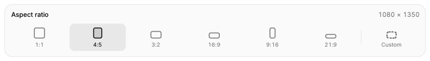

# Aspect ratio picker

Use an aspect ratio picker to choose the shape of a picture or frame.
The gallery shows six presets and a Custom choice.
Available in **GUI**.



## Example

```pascal
unit Docs.Ui.CreativeControls.AspectRatioPicker;

uses Fpas.Ui.Elements as E, Fpas.Ui.Widgets.Pickers.AspectPickers as W;

// Shows the output ratio picker.
// ## Parameters
// - `Selected`: Zero-based ratio index, including the final Custom slot.
// ## Returns
// The picker with the proposed index as its message.
public function View(Selected: int): E.Element<int>;
begin
  return W.AspectPicker<int>('output-ratio', new W.Value('Aspect ratio', Selected),
    function(Index: int): int => Index, new W.Options(Custom := true));
end function;

end unit;
```

## Options and defaults

| Option | Default or requirement |
| --- | --- |
| `Ratios` | Empty uses 1:1, 4:5, 3:2, 16:9, 9:16 and 21:9. |
| `Custom / CustomLabel` | false / empty. Custom adds a final choice. |
| `Base / Display` | 0 / empty. Zero uses 1080 pixels for the short side. A negative Base hides the size. |
| `Plain / Enabled` | false / true. |

## Interaction

Click a shape or move with the arrow keys. Store the proposed index.
Handle the Custom selection in your application to offer custom dimensions.

## See also

- [Widget API and types](../../../../src/Fpas.Ui/Widgets/Pickers/AspectPickers.fpas)
- [Gallery example](../../../../examples/ui/gui/gallery/Pages/Creative/View.fpas)
- [Creative controls](README.md)
