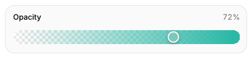

# Gradient slider

Use a gradient slider when the track shows how the value affects color.
The gallery shows hue, white balance and opacity.
Available in **GUI**.


## Example

```pascal
unit Docs.Ui.CreativeControls.GradientSlider;

uses Fpas.Ui.Elements as E, Fpas.Ui.Widgets.Inputs.GradientSliders as W;

// Shows a hue slider with a swatch.
// ## Parameters
// - `Hue`: Current hue in degrees from zero through 360.
// ## Returns
// The slider with numeric and color proposals.
public function View(Hue: float): E.Element<W.Event>;
begin
  return W.GradientSlider<W.Event>('hue', new W.Value('Hue', Hue, 0.0F, 360.0F),
    function(Change: W.Event): W.Event => Change, new W.Options(Swatch := true));
end function;

end unit;
```

## Options and defaults

| Option | Default or requirement |
| --- | --- |
| `Kind / Stops / Color` | Hue / empty / Automatic. Built-in tracks are Hue, Temperature and Opacity. Custom stops use ascending normalized positions. Color tints the opacity track. |
| `Step / Format / Display` | 0 / null / empty. Zero permits continuous input. Display takes precedence over Format. |
| `Swatch / Tool / Plain / Enabled` | false / null / false / true. Tool adds an action. Plain omits the surrounding well. |

## Interaction

Store `Event.Current` when `Changed` is true. `Color` gives the color
under the thumb. `Action` reports tool activation, such as the eyedropper.



## See also

- [Widget API and types](../../../../src/Fpas.Ui/Widgets/Inputs/GradientSliders.fpas)
- [Gallery example](../../../../examples/ui/gui/gallery/Pages/Creative/View.fpas)
- [Gradient editor](../editing-tools/gradient-editor.md)
- [Creative controls](README.md)
