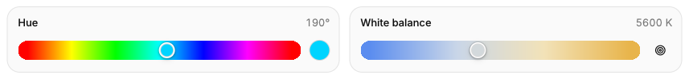

# Gradient slider

Use a gradient slider when the track shows how the value affects color.
The gallery shows hue, white balance and opacity.
Available in **GUI**.



## Example

```pascal
unit Docs.Ui.CreativeControls.GradientSlider;

uses Fpas.Ui.Elements as E;
uses Fpas.Ui.Widgets.Inputs.GradientSliders as W;

// Shows a hue slider with a swatch.
// ## Parameters
// - `Hue`: Current hue in degrees from zero through 360.
// ## Returns
// The slider with numeric and color proposals.
public function View(Hue: float): E.Element of W.Event;
begin
  return W.GradientSlider of W.Event('hue', new W.Value('Hue', Hue, 0.0F, 360.0F),
    function(Change: W.Event): W.Event => Change, new W.Options(Swatch := true));
end function;

end unit;
```

## Options and defaults

| Option | Default or requirement |
| --- | --- |
| `Label` | Supply the caption. A leading `##` hides the caption. |
| `Minimum / Maximum / Current` | Supply a finite increasing range and a current value within it. |
| `Kind` | `Hue`. Other presets are `Temperature` and `Opacity`. |
| `Stops` | Empty uses the preset. Custom stops replace the preset and use positions in ascending order from 0 through 1. |
| `Color` | `Automatic` uses the theme accent for the opacity track. Supply a theme color or RGBA color to change the tint. |
| `Step` | Zero permits continuous pointer input and sets the arrow increment to one percent of the range. A positive step snaps edits from the minimum. |
| `Format` | Null uses degrees, kelvin, percentage of range, or an integer for custom stops. Supply a [numeric format](../charts/README.md#value-format) to change the value text. |
| `Display` | Empty uses formatted value text. Supply a caption to override it. |
| `Swatch` | False. True draws a sample after the track. |
| `Tool` | Null. Supply a tool with an icon, tooltip, and pressed state to add an action. |
| `Plain` | False. True omits the surrounding well. |
| `Enabled` | True. False disables the track and tool. |

## Interaction

Drag the thumb or use the arrow keys. Shift multiplies the keyboard increment
by ten. Home and End select the exact endpoints.

`Change` receives an event when the value changes or the tool activates.
Use `Changed` to store the proposed `Current`. Use `Action` to handle the tool
activation. Both flags can be true in the same event. `Color` is the RGBA
sample at the proposed value.

`CuiWindow.GradientSlider` also writes the RGBA sample to its `sample` output
on every draw.


## See also

- [CUI widget inventory](../../../cui-widget-inventory.md#cui_gradient_slider)
- [Widget API and types](../../../../src/Fpas.Ui/Widgets/Inputs/GradientSliders.fpas)
- [Gallery example](../../../../examples/ui/gui/gallery/Pages/Creative/View.fpas)
- [Gradient editor](../editing-tools/gradient-editor.md)
- [Creative controls](README.md)

## Source files

- `src/Fpas.Ui.Gui/Internal/Widgets/Inputs/`
  - [GradientSlider.fpas](../../../../src/Fpas.Ui.Gui/Internal/Widgets/Inputs/GradientSlider.fpas)
- `src/Fpas.Ui.Gui.Cui/Interop/Inputs/`
  - [NativeMethods.GradientSlider.cs](../../../../src/Fpas.Ui.Gui.Cui/Interop/Inputs/NativeMethods.GradientSlider.cs)
- `src/Fpas.Ui.Gui.Cui/Widgets/Inputs/`
  - [CuiWindow.GradientSlider.cs](../../../../src/Fpas.Ui.Gui.Cui/Widgets/Inputs/CuiWindow.GradientSlider.cs)
- `src/Fpas.Ui.Gui.Cui/native/widgets/inputs/`
  - [gradient_slider.c](../../../../src/Fpas.Ui.Gui.Cui/native/widgets/inputs/gradient_slider.c)
  - [gradient_slider.h](../../../../src/Fpas.Ui.Gui.Cui/native/widgets/inputs/gradient_slider.h)
