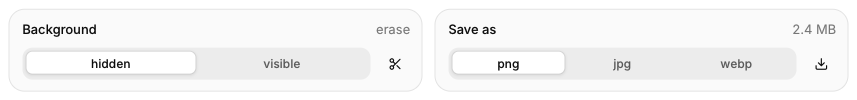

# Option field with action

Use this control when a segmented choice controls a nearby action.
The gallery pairs the image format with Download.
Available in **GUI**.



## Example

```pascal
unit Docs.Ui.CreativeControls.OptionAction;

uses Fpas.Ui.Elements as E;
uses Fpas.Ui.Widgets.Actions.OptionActions as W;
uses Fpas.Ui.Widgets.Audio.ControlWells as Tools;
uses System as Sys;

// Chooses an export format and offers Download.
// ## Parameters
// - `Format`: Zero-based index for PNG, JPG or WebP.
// ## Returns
// The field with selection and action proposals.
public function View(Format: int): E.Element of W.Event;
begin
  const Download: Tools.Tool := new Tools.Tool(Sys.Char.ConvertFromUtf32($E0B2), 'Download');
  return W.OptionAction of W.Event('export',
    new W.Value('Save as', ['png', 'jpg', 'webp'], Format, Download),
    function(Change: W.Event): W.Event => Change);
end function;

end unit;
```

## Options and defaults

| Field | Default and behavior |
| --- | --- |
| `Items` | Supply one to 32 option captions in order. |
| `Index` | Supply the zero-based index of the selected option. |
| `Tool` | Null omits the action button. Supply an icon and an optional tooltip. Set `Active` to show the button pressed. |
| `Display` | Empty. Supply text to display it beside the well caption. |
| `Plain` | False. Set true to omit the well background and border. |
| `ActionEnabled` | True. Set false to disable the action button. |
| `Enabled` | True. Set false to disable input for the entire control. |

## Interaction

Click an option, or press Tab to focus a choice and move the selection
with Left or Right. Press Enter or Space to select the focused option.
Tab also reaches the enabled action button. Click the button or press
Enter or Space to activate it.

If `Changed` is true, store the proposed `Index` in the model. If `Action`
is true, use the same index to run the operation.

## See also

- [CUI widget inventory](../../../cui-widget-inventory.md#cui_option_action)
- [Widget API and types](../../../../src/Fpas.Ui/Widgets/Actions/OptionActions.fpas)
- [Gallery example](../../../../examples/ui/gui/gallery/Pages/Creative/View.fpas)
- [Creative controls](README.md)

## Source files

- `src/Fpas.Ui.Gui/Internal/Widgets/Actions/`
  - [OptionAction.fpas](../../../../src/Fpas.Ui.Gui/Internal/Widgets/Actions/OptionAction.fpas)
- `src/Fpas.Ui.Gui.Cui/Interop/Actions/`
  - [NativeMethods.OptionAction.cs](../../../../src/Fpas.Ui.Gui.Cui/Interop/Actions/NativeMethods.OptionAction.cs)
- `src/Fpas.Ui.Gui.Cui/Widgets/Actions/`
  - [CuiWindow.OptionAction.cs](../../../../src/Fpas.Ui.Gui.Cui/Widgets/Actions/CuiWindow.OptionAction.cs)
- `src/Fpas.Ui.Gui.Cui/native/widgets/actions/`
  - [option_action.c](../../../../src/Fpas.Ui.Gui.Cui/native/widgets/actions/option_action.c)
  - [option_action.h](../../../../src/Fpas.Ui.Gui.Cui/native/widgets/actions/option_action.h)
