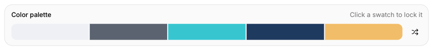

# Palette strip

The gallery varies a five-swatch palette with a model-owned shuffle seed.
Available in **GUI**.



## Example

```pascal
unit Docs.Ui.CreativeControls.PaletteStrip;

uses Fpas.Ui.Elements as E;
uses Fpas.Ui.Widgets.Pickers.PaletteStrips as W;

// Displays the current palette.
// ## Parameters
// - `Current`: Swatches, locks and optional shuffle seed.
// ## Returns
// The palette with lock and shuffle proposals.
public function View(Current: W.Value): E.Element of W.Event;
begin
  return W.PaletteStrip of W.Event('palette', Current,
    function(Change: W.Event): W.Event => Change);
end function;

end unit;
```

## Options and defaults

| Option | Default or requirement |
| --- | --- |
| `Value.Swatches / Swatch.Locked` | Supply one to sixteen `Swatch` records with a color and optional lock. Each lock defaults to false. |
| `Seed / NoShuffle` | null / false. Pass a seed to let CUI shuffle unlocked swatches. |
| `Display / Height / Plain / Enabled` | Empty / 0 / false / true. Zero height uses the native size. |

## Interaction

Click a swatch to toggle its lock. With a seed, store the proposed
swatches and new seed after shuffling. With a null seed, handle
`Shuffled` in the application to choose new colors.

## See also

- [CUI widget inventory](../../../cui-widget-inventory.md#cui_palette_strip)
- [Widget API and types](../../../../src/Fpas.Ui/Widgets/Pickers/PaletteStrips.fpas)
- [Gallery example](../../../../examples/ui/gui/gallery/Pages/Creative/View.fpas)
- [Creative controls](README.md)

## Source files

- `src/Fpas.Ui.Gui/Internal/Widgets/Pickers/`
  - [PaletteStrip.fpas](../../../../src/Fpas.Ui.Gui/Internal/Widgets/Pickers/PaletteStrip.fpas)
- `src/Fpas.Ui.Gui.Cui/Interop/Pickers/`
  - [NativeMethods.PaletteStrip.cs](../../../../src/Fpas.Ui.Gui.Cui/Interop/Pickers/NativeMethods.PaletteStrip.cs)
- `src/Fpas.Ui.Gui.Cui/Widgets/Pickers/`
  - [CuiWindow.PaletteStrip.cs](../../../../src/Fpas.Ui.Gui.Cui/Widgets/Pickers/CuiWindow.PaletteStrip.cs)
- `src/Fpas.Ui.Gui.Cui/native/widgets/pickers/`
  - [palette_strip.c](../../../../src/Fpas.Ui.Gui.Cui/native/widgets/pickers/palette_strip.c)
  - [palette_strip.h](../../../../src/Fpas.Ui.Gui.Cui/native/widgets/pickers/palette_strip.h)
