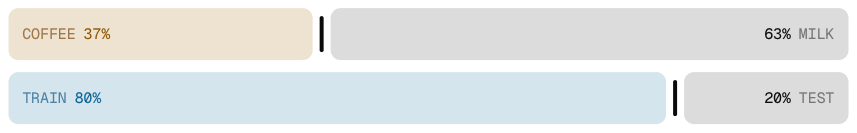

# Ratio slider

Use a ratio slider for two shares that add up to one. The gallery shows
Coffee and Milk and a Train and Test split.
Available in **GUI**.



## Example

```pascal
unit Docs.Ui.CreativeControls.RatioSlider;

uses Fpas.Ui.Elements as E;
uses Fpas.Ui.Widgets.Inputs.RatioSliders as W;

// Sets the coffee fraction in a blend.
// ## Parameters
// - `Coffee`: Current coffee share from zero through one.
// ## Returns
// The slider with a proposed fraction as its message.
public function View(Coffee: float): E.Element of float;
begin
  return W.RatioSlider of float('blend', new W.Value('COFFEE', 'MILK', Coffee),
    function(Value: float): float => Value);
end function;

end unit;
```

## Options and defaults

| Option | Default or requirement |
| --- | --- |
| `First / Second / Ratio` | Supply both labels and the first part's share. The second share is one minus Ratio. |
| `Tone / Step` | Neutral / 0. Zero Step uses one percentage point. |
| `Height / Width / Enabled` | 0 / Fill / true. Zero height uses native sizing. |

## Interaction

Drag the divider or use the arrow keys. Shift increases the keyboard step.
Store the proposed first share in the model.

## See also

- [Widget API and types](../../../../src/Fpas.Ui/Widgets/Inputs/RatioSliders.fpas)
- [Gallery example](../../../../examples/ui/gui/gallery/Pages/Creative/View.fpas)
- [Creative controls](README.md)

## Source files

- `src/Fpas.Ui.Gui/Internal/Widgets/Inputs/`
  - [RatioSlider.fpas](../../../../src/Fpas.Ui.Gui/Internal/Widgets/Inputs/RatioSlider.fpas)
- `src/Fpas.Ui.Gui.Cui/Interop/Inputs/`
  - [NativeMethods.RatioSlider.cs](../../../../src/Fpas.Ui.Gui.Cui/Interop/Inputs/NativeMethods.RatioSlider.cs)
- `src/Fpas.Ui.Gui.Cui/Widgets/Inputs/`
  - [CuiWindow.RatioSlider.cs](../../../../src/Fpas.Ui.Gui.Cui/Widgets/Inputs/CuiWindow.RatioSlider.cs)
- `src/Fpas.Ui.Gui.Cui/native/widgets/inputs/`
  - [ratio_slider.c](../../../../src/Fpas.Ui.Gui.Cui/native/widgets/inputs/ratio_slider.c)
  - [ratio_slider.h](../../../../src/Fpas.Ui.Gui.Cui/native/widgets/inputs/ratio_slider.h)
