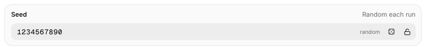

# Seed field

Use a seed field to vary generated results or keep a seed for reuse.
The gallery uses a dice button and a lock.
Available in **GUI**.



## Example

```pascal
unit Docs.Ui.CreativeControls.SeedField;

uses Fpas.Ui.Elements as E, Fpas.Ui.Widgets.Inputs.SeedFields as W;

// Edits an image generation seed.
// ## Parameters
// - `Seed`: Current seed.
// - `Locked`: Whether to keep the current seed.
// ## Returns
// The field with seed and lock proposals.
public function View(Seed: uint; Locked: bool): E.Element<W.Event>;
begin
  return W.SeedField<W.Event>('seed', new W.Value('Seed', Seed, Locked),
    function(Change: W.Event): W.Event => Change);
end function;

end unit;
```

## Options and defaults

| Option | Default or requirement |
| --- | --- |
| `Seed / Locked` | Supply an unsigned integer. Locked defaults to null, which hides the lock. |
| `Display / RandomText / FixedText` | All empty. Supply captions to override native text. |
| `Plain / Enabled` | false / true. |

## Interaction

Press the dice to propose a new seed. Locking it keeps the value and
disables the dice. Store the seed and lock state to use when generating
a result.

## See also

- [Widget API and types](../../../../src/Fpas.Ui/Widgets/Inputs/SeedFields.fpas)
- [Gallery example](../../../../examples/ui/gui/gallery/Pages/Creative/View.fpas)
- [Creative controls](README.md)
