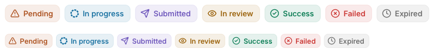

# Status tag

A status tag shows a workflow state in a tinted label. The gallery shows all
seven presets in standard and compact sizes. Available in **GUI**.



## Example

```pascal
unit Docs.Ui.CreativeControls.StatusTag;

uses Fpas.Ui.Elements as E;
uses Fpas.Ui.Widgets.Feedback.StatusTags as W;

// Displays a removable review status.
// ## Parameters
// - `Label`: Caption, or empty for the preset caption.
// ## Returns
// The status tag with a removal message.
public function View(Label: string): E.Element of string;
begin
  return W.StatusTag of string('review', new W.Value(Label, W.Status.InReview),
    function(): string => 'remove-review', new W.Options(Small := true));
end function;

end unit;
```

## Options and defaults

| Option | Default or requirement |
| --- | --- |
| `Id` | Required. Use a stable ID for each tag, including tags with the same label. |
| `Value.Label` | Empty. An empty label uses the preset caption. |
| `Value.Preset` | `Pending`. The presets are `Pending`, `InProgress`, `Submitted`, `InReview`, `Success`, `Failed`, and `Expired`. |
| `Small` | `false`. The standard height is 30 logical units. The compact height is 24. |
| `Icon` | Empty. An empty icon keeps the preset icon. Supply a CUI icon glyph to replace it. |
| `Tone` | `Neutral`. Neutral keeps the preset color. |
| `Remove` | `null`. Supply a callback to make the tag removable. |
| `Enabled` | `true`. Set to `false` to dim a removable tag and prevent input. |

## Interaction

The `InProgress` preset shows a dashed ring that completes one turn in 2.4
seconds. The ring holds still when reduced motion is active. A replacement icon
takes the place of the ring. For a custom state, use `Status.Custom` and supply a
label. With the default options, a custom tag displays its label in gray.

A removable tag shows an × on hover or keyboard focus. Click the tag to send
the removal message. With keyboard focus, press Enter, Space, Delete, or Backspace.
Update the model to remove the tag from the view.

## See also

- [CUI widget inventory](../../../cui-widget-inventory.md#cui_status_tag)
- [Widget API and types](../../../../src/Fpas.Ui/Widgets/Feedback/StatusTags.fpas)
- [Gallery example](../../../../examples/ui/gui/gallery/Pages/Creative/View.fpas)
- [Creative controls](README.md)

## Source files

- `src/Fpas.Ui.Gui/Internal/Widgets/Feedback/`
  - [StatusTag.fpas](../../../../src/Fpas.Ui.Gui/Internal/Widgets/Feedback/StatusTag.fpas)
- `src/Fpas.Ui.Gui.Cui/Interop/Feedback/`
  - [NativeMethods.StatusTag.cs](../../../../src/Fpas.Ui.Gui.Cui/Interop/Feedback/NativeMethods.StatusTag.cs)
- `src/Fpas.Ui.Gui.Cui/Widgets/Feedback/`
  - [CuiWindow.StatusTag.cs](../../../../src/Fpas.Ui.Gui.Cui/Widgets/Feedback/CuiWindow.StatusTag.cs)
- `src/Fpas.Ui.Gui.Cui/native/widgets/feedback/`
  - [status_tag.c](../../../../src/Fpas.Ui.Gui.Cui/native/widgets/feedback/status_tag.c)
  - [status_tag.h](../../../../src/Fpas.Ui.Gui.Cui/native/widgets/feedback/status_tag.h)
