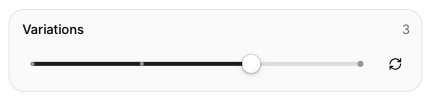

# Step slider

The gallery selects one to four variations and offers a Generate action.
Available in **GUI**.



## Example

```pascal
unit Docs.Ui.CreativeControls.StepSlider;

uses Fpas.Ui.Elements as E;
uses Fpas.Ui.Widgets.Audio.ControlWells as Tools;
uses Fpas.Ui.Widgets.Inputs.StepSliders as W;
uses System as Sys;

// Chooses the number of variations to generate.
// ## Parameters
// - `Count`: Current number of variations from one through four.
// ## Returns
// The slider with stop changes and Generate requests.
public function View(Count: int): E.Element of W.Event;
begin
  return W.StepSlider of W.Event('variants', new W.Value('Variations', Count, 1, 4),
    function(Change: W.Event): W.Event => Change,
    new W.Options(Tool := new Tools.Tool(Sys.Char.ConvertFromUtf32($E145), 'Generate')));
end function;

end unit;
```

## Options and defaults

| Option | Default or requirement |
| --- | --- |
| `Label` | Supply the caption. A leading `##` hides the caption. |
| `Minimum / Maximum / Current` | Supply increasing integer endpoints and a current stop in that range. The endpoints can differ by up to 16,777,216. |
| `Labels` | Empty. Supply one caption for each stop to override formatted values. |
| `Format` | Empty displays the integer. A format can contain one `%d` slot and escaped `%%` signs. |
| `Display` | Empty. Supply a caption to override stop labels and formatted values. |
| `Tool` | Null. Supply a tool with an icon, tooltip, and pressed state to add an action. |
| `Plain` | False. True omits the surrounding well. |
| `Enabled` | True. False disables the track and tool. |

## Interaction

Drag the thumb or use the arrow keys. Each arrow moves one stop. Shift moves
up to ten stops. Home and End select the first and last stops.

`Change` receives an event when the stop changes or the tool activates.
Use `Changed` to store the proposed `Current`. Use `Action` to run the operation
with that stop. Both flags can be true in the same event.

## See also

- [CUI widget inventory](../../../cui-widget-inventory.md#cui_step_slider)
- [Widget API and types](../../../../src/Fpas.Ui/Widgets/Inputs/StepSliders.fpas)
- [Gallery example](../../../../examples/ui/gui/gallery/Pages/Creative/View.fpas)
- [Creative controls](README.md)

## Source files

- `src/Fpas.Ui.Gui/Internal/Widgets/Inputs/`
  - [StepSlider.fpas](../../../../src/Fpas.Ui.Gui/Internal/Widgets/Inputs/StepSlider.fpas)
- `src/Fpas.Ui.Gui.Cui/Interop/Inputs/`
  - [NativeMethods.StepSlider.cs](../../../../src/Fpas.Ui.Gui.Cui/Interop/Inputs/NativeMethods.StepSlider.cs)
- `src/Fpas.Ui.Gui.Cui/Widgets/Inputs/`
  - [CuiWindow.StepSlider.cs](../../../../src/Fpas.Ui.Gui.Cui/Widgets/Inputs/CuiWindow.StepSlider.cs)
- `src/Fpas.Ui.Gui.Cui/native/widgets/inputs/`
  - [step_slider.c](../../../../src/Fpas.Ui.Gui.Cui/native/widgets/inputs/step_slider.c)
  - [step_slider.h](../../../../src/Fpas.Ui.Gui.Cui/native/widgets/inputs/step_slider.h)
- `tests/Fpas.Ui.Gui.Cui.Tests/Inputs/`
  - [CuiStepSliderTests.cs](../../../../tests/Fpas.Ui.Gui.Cui.Tests/Inputs/CuiStepSliderTests.cs)
