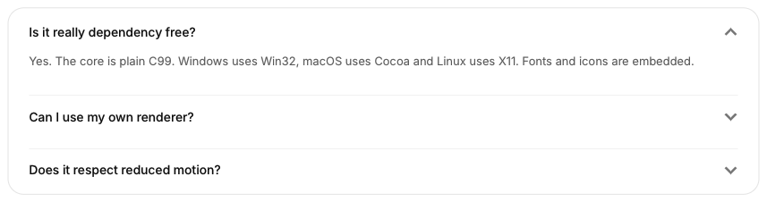

# Accordion

Use an accordion header to show or hide a section of related content. Available in **GUI**.



## Example

```pascal
unit Docs.Ui.DataDisplay.Accordion;

uses Fpas.Ui.Elements as E;
uses Fpas.Ui.Widgets.Containers.Accordions as W;

// Builds the accordion example.
// ## Parameters
// - `Open`: Expansion flag from the application model.
// ## Returns
// The widget for the application view.
public function View(Open: bool): E.Element of bool;
begin
  return W.Accordion of bool('reduced-motion', 'Does it respect reduced motion?', Open,
    function(Expanded: bool): bool => Expanded,
    E.Text of bool('Every animation has a reduced motion path.'));
end function;

end unit;
```

## Options and defaults

| Option | Default or requirement |
| --- | --- |
| `Open` | The current model flag. |
| `Content` | The body displayed under the header. |
| `Enabled` | true. |

## Interaction

Click the header or focus it and press Enter or Space to propose a new flag. Compose several sections by giving each header a stable ID. For exclusive expansion, close the other sections in the update.

## See also

- [CUI widget inventory](../../../cui-widget-inventory.md#cui_accordion)
- [Widget API and types](../../../../src/Fpas.Ui/Widgets/Containers/Accordions.fpas)
- [Gallery example](../../../../examples/ui/gui/gallery/Pages/Lists/View.fpas)
- [Expandable card](../disclosure/expandable-card.md)
- [Data display](README.md)

## Source files

- [Disclosure.fpas](../../../../src/Fpas.Ui.Gui/Internal/Widgets/Containers/Disclosure.fpas)
