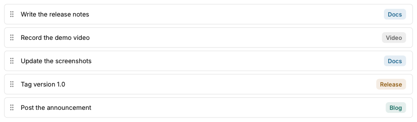

# Reorderable list

Use a reorderable list to let the user arrange a small set of items by dragging. Available in **GUI**.



## Example

```pascal
unit Docs.Ui.DataDisplay.ReorderableList;

uses Fpas.Ui.Elements as E;
uses Fpas.Ui.Widgets.Collections.ReorderableLists as W;

// Builds the reorderable list example.
// ## Parameters
// - `Order`: Current sort from the model.
// ## Returns
// The widget for the application view.
public function View(Order: array of int): E.Element<array of int>;
begin
  return W.ReorderableList<array of int>('task-order', [
    E.Text<array of int>('Write the release notes'),
    E.Text<array of int>('Update the screenshots'),
    E.Text<array of int>('Tag the release')
  ], Order, function(Proposed: array of int): array of int => Proposed);
end function;

end unit;
```

## Options and defaults

| Option | Default or requirement |
| --- | --- |
| `Items` | One through 256 children in canonical index order. |
| `Order` | A permutation of the zero-based item indices. Use [0, 1, 2] for the example's initial order. |
| `Enabled` | true. Controls native dragging. |

## Interaction

Drag a row by its handle. CUI moves the surrounding rows and proposes a new permutation. Store that permutation to accept the new order. Keep the canonical items in place when applying the permutation.

## See also

- [Widget API and types](../../../../src/Fpas.Ui/Widgets/Collections/ReorderableLists.fpas)
- [Gallery example](../../../../examples/ui/gui/gallery/Pages/Lists/Widgets/Tasks.fpas)
- [Virtual list](virtual-list.md)
- [Data display](README.md)

## Source files

- `src/Fpas.Ui.Gui/Internal/Widgets/Collections/`
  - [ReorderableList.fpas](../../../../src/Fpas.Ui.Gui/Internal/Widgets/Collections/ReorderableList.fpas)
- `src/Fpas.Ui.Gui.Cui/Interop/Collections/`
  - [NativeMethods.ReorderableList.cs](../../../../src/Fpas.Ui.Gui.Cui/Interop/Collections/NativeMethods.ReorderableList.cs)
- `src/Fpas.Ui.Gui.Cui/Widgets/Collections/`
  - [CuiWindow.ReorderableList.cs](../../../../src/Fpas.Ui.Gui.Cui/Widgets/Collections/CuiWindow.ReorderableList.cs)
- `src/Fpas.Ui.Gui.Cui/native/widgets/collections/`
  - [reorderable_list.c](../../../../src/Fpas.Ui.Gui.Cui/native/widgets/collections/reorderable_list.c)
  - [reorderable_list.h](../../../../src/Fpas.Ui.Gui.Cui/native/widgets/collections/reorderable_list.h)
- `tests/Fpas.Ui.Gui.Cui.Tests/Display/`
  - [CuiReorderableListTests.cs](../../../../tests/Fpas.Ui.Gui.Cui.Tests/Display/CuiReorderableListTests.cs)
