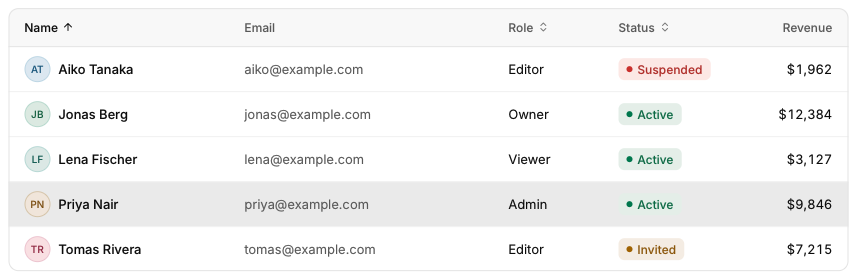

# Table

Use a table for a collection with columns, optional sorting and row selection. The gallery puts avatars and badges directly into cells. The [terminal table](../../tui/data-display/table.md) displays text cells.



## Example

```pascal
unit Docs.Ui.DataDisplay.Table;

uses Fpas.Ui.Elements as E;
uses Fpas.Ui.Widgets.Collections.Tables as W;

// Messages proposed by a sort header or selectable row.
public type Msg = variant
  // Apply the proposed sort to the model's rows.
  SortBy(Value: W.Sort);
  // Select the row with this stable ID.
  SelectPerson(Id: string);
end variant;

// Builds the table example.
// ## Parameters
// - `Rows`: Rows in the model's display order.
// - `Order`: Current sort from the model.
// ## Returns
// The widget for the application view.
public function View(Rows: array of W.Row<Msg>; Order: W.Sort): E.Element<Msg>;
begin
  return W.Table<Msg>('people', [
    new W.Column('Name', Sortable := true),
    new W.Column('Status')
  ], Rows, Order, Msg.SortBy, Msg.SelectPerson);
end function;

end unit;
```

## Options and defaults

| Option | Default or requirement |
| --- | --- |
| `Columns` | Provide a heading per column. Width defaults to Fill, Grow to 1, alignment to Left and Sortable to false. |
| `Rows` | Pass the rows in display order with stable IDs and one cell per column. Cell.Text is plain text. Cell.Content holds graphical children. |
| `Order / OnSort` | Both default to null. Pair the current Sort with a callback when using sortable headings. Column -1 means unsorted. |
| `OnSelect` | Optional callback receiving the row ID. The model sets each row's Selected flag. |
| `Height / Striped / Compact / Enabled` | Content / false / false / true. Content fits all rows. |

## Interaction

Activate a sortable heading to propose a column and direction. Sort the rows
in the update and pass them back with the new sort. Keep each row ID stable
across sorting so focus follows the row. Store selection by row ID in the model
to preserve the selected record. Use `HeaderId(Id, Index)` to address a heading
for focus.

Use a [data grid](../data-grid/data-grid.md) for large collections whose rows
should be built on demand. The row factory maps each display position to its
record and returns a stable ID for that record.

## See also

- [Widget API and types](../../../../src/Fpas.Ui/Widgets/Collections/Tables.fpas)
- [Gallery example](../../../../examples/ui/gui/gallery/Pages/Lists/Widgets/People.fpas)
- [Gallery update](../../../../examples/ui/gui/gallery/Pages/Lists/Update.fpas)
- [Virtual list](virtual-list.md)
- [Data grid API](../../widgets.md#data-grid-filter-bar-and-tree-table)
- [Data display](README.md)

## Source files

- [PeopleTable.fpas](../../../../examples/ui/gui/gallery/Shared/PeopleTable.fpas) supplies the sample people, headings and stable sort to both galleries.

- `src/Fpas.Ui.Gui/Internal/Widgets/Collections/`
  - [Table.fpas](../../../../src/Fpas.Ui.Gui/Internal/Widgets/Collections/Table.fpas)
- `src/Fpas.Ui.Gui.Cui/Interop/Collections/`
  - [NativeMethods.Table.cs](../../../../src/Fpas.Ui.Gui.Cui/Interop/Collections/NativeMethods.Table.cs)
- `src/Fpas.Ui.Gui.Cui/Widgets/Collections/`
  - [CuiWindow.Table.Types.cs](../../../../src/Fpas.Ui.Gui.Cui/Widgets/Collections/CuiWindow.Table.Types.cs)
  - [CuiWindow.Table.cs](../../../../src/Fpas.Ui.Gui.Cui/Widgets/Collections/CuiWindow.Table.cs)
- `src/Fpas.Ui.Gui.Cui/native/widgets/collections/`
  - [table.c](../../../../src/Fpas.Ui.Gui.Cui/native/widgets/collections/table.c)
  - [table.h](../../../../src/Fpas.Ui.Gui.Cui/native/widgets/collections/table.h)
- `tests/Fixtures/gui-host/`
  - [GalleryTableContract.fpas](../../../../tests/Fixtures/gui-host/GalleryTableContract.fpas)
