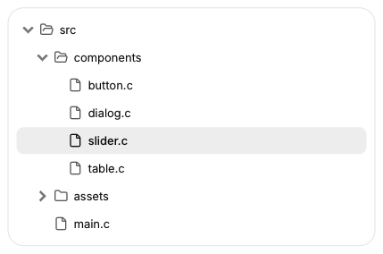

# Tree

Use a tree for nested nodes such as files and folders. Compose each group with Branch and each final item with Leaf. Available in **GUI**.



## Example

```pascal
unit Docs.Ui.DataDisplay.Tree;

uses Fpas.Ui.Elements as E, Fpas.Ui.Widgets.Collections.Trees as W;

// Changes proposed by the source tree.
public type Msg = variant
  // Change the expansion of the source branch.
  SetSource(Open: bool);
  // Select a file by name.
  SelectFile(Name: string);
end variant;

// Builds the tree example.
// ## Parameters
// - `Open`: Expansion flag from the application model.
// ## Returns
// The widget for the application view.
public function View(Open: bool): E.Element<Msg>;
begin
  return W.Branch<Msg>('tree-src', 'src', Open, [
    W.Leaf<Msg>('file-main', 'main.c', function(): Msg => Msg.SelectFile('main.c')),
    W.Leaf<Msg>('file-table', 'table.c', function(): Msg => Msg.SelectFile('table.c'))
  ], Msg.SetSource);
end function;

end unit;
```

## Options and defaults

| Option | Default or requirement |
| --- | --- |
| `Open / OnChange` | Pass the current flag to Branch and handle the next flag in the model. |
| `OnActivate` | Optional message factory for a leaf. |
| `Icon` | Empty uses the native file or folder icon. |
| `Selected / Enabled` | false / true. Pass selection from the model. |

## Interaction

Expand or collapse a branch at its header. CUI draws the chevron and indents its children. Activating a leaf sends its own message. Give each branch and leaf a stable ID independent of its caption.

## See also

- [Widget API and types](../../../../src/Fpas.Ui/Widgets/Collections/Trees.fpas)
- [Gallery example](../../../../examples/ui/gui/gallery/Pages/Lists/Widgets/TreeAndList.fpas)
- [List item](list-item.md)
- [Data display](README.md)
