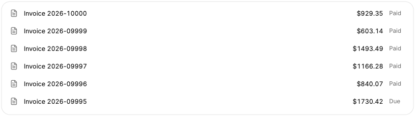

# Virtual list

Use a virtual list to show a large collection with rows of equal height. The gallery uses a row factory for 10,000 invoices. Available in **GUI**.



## Example

```pascal
unit Docs.Ui.DataDisplay.VirtualList;

uses Fpas.Ui.Elements as E;
uses Fpas.Ui.Layout as L;
uses Fpas.Ui.Widgets.Collections.VirtualLists as W;

// Builds the virtual list example.
// ## Parameters
// - `Count`: Number of available rows.
// ## Returns
// The widget for the application view.
public function View(Count: int): E.Element of string;
begin
  return W.VirtualList of string('invoices', Count, 36.0F,
    L.Extent.Fixed(L.Measure.Logical(220)),
    function(Index: int): E.Element of string => E.Text of string('Invoice ' + (Index + 1).ToString()));
end function;

end unit;
```

## Options and defaults

| Option | Default or requirement |
| --- | --- |
| `Count` | Number of rows in the current model. |
| `RowHeight` | Fixed logical height of at least one point. |
| `Height` | Viewport extent. The example uses 220 logical points. |
| `BuildRow` | A pure function that builds a row from its zero-based index. |
| `Offset` | Optional saved scroll offset in logical points, restored when the list appears. |
| `OnScroll` | Optional callback reporting the native scroll offset to store for a later visit. |

## Interaction

Scrolling changes which rows CUI requests. The factory can also receive rows just outside the viewport so scrolling has content ready. Give interactive children stable IDs unique across the view. The GUI snapshot reports the realized range as `first:last`, with last excluded.

Declare open modal scopes outside `BuildRow`. The GUI validates each realized
row before drawing it and rejects open dialogs, sheets, command palettes and
file pickers in its content. Rows outside the realized range remain unbuilt.

## See also

- [Widget API and types](../../../../src/Fpas.Ui/Widgets/Collections/VirtualLists.fpas)
- [Gallery example](../../../../examples/ui/gui/gallery/Pages/Lists/Widgets/Invoices.fpas)
- [Table](table.md)
- [Data display](README.md)

## Source files

- `src/Fpas.Ui.Gui/Internal/Widgets/Collections/`
  - [VirtualList.fpas](../../../../src/Fpas.Ui.Gui/Internal/Widgets/Collections/VirtualList.fpas)
- `src/Fpas.Ui.Gui.Cui/Interop/Collections/`
  - [NativeMethods.VirtualList.cs](../../../../src/Fpas.Ui.Gui.Cui/Interop/Collections/NativeMethods.VirtualList.cs)
- `src/Fpas.Ui.Gui.Cui/Widgets/Collections/`
  - [CuiWindow.VirtualList.Types.cs](../../../../src/Fpas.Ui.Gui.Cui/Widgets/Collections/CuiWindow.VirtualList.Types.cs)
  - [CuiWindow.VirtualList.cs](../../../../src/Fpas.Ui.Gui.Cui/Widgets/Collections/CuiWindow.VirtualList.cs)
- `src/Fpas.Ui.Gui.Cui/native/widgets/collections/`
  - [virtual_list.c](../../../../src/Fpas.Ui.Gui.Cui/native/widgets/collections/virtual_list.c)
  - [virtual_list.h](../../../../src/Fpas.Ui.Gui.Cui/native/widgets/collections/virtual_list.h)
