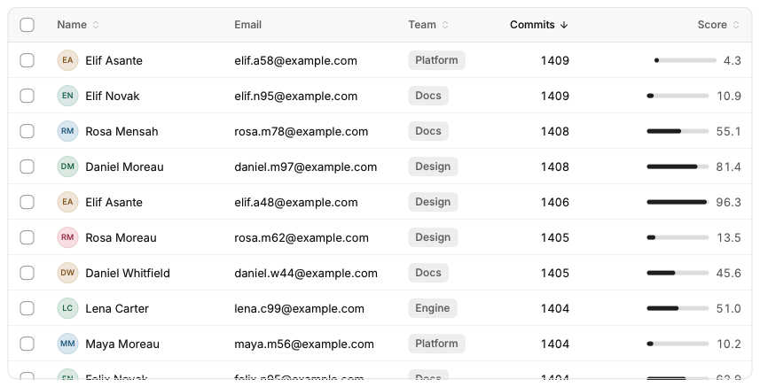

# Data grid

Use a data grid to show rows built when they become visible. The gallery shows
2,000 people with sortable columns, editable names and composed score cells.
Available in **GUI**.



## Example

```pascal
unit Docs.Ui.DataGrid.DataGrid;

uses Fpas.Ui.Elements as E, Fpas.Ui.Layout as L,
  Fpas.Ui.Widgets.Collections.DataGrids as W;

// Builds a virtual grid for two text columns.
// ## Parameters
// - `Count`: Number of rows in model order.
// - `BuildRow`: Pure factory supplying a stable row ID and two cells.
// - `Current`: Selection, ordering, cursor and anchor in display order.
// ## Returns
// The grid with proposed state changes as application messages.
public function View(Count: int; BuildRow: function(int): W.Row<W.Value>;
  Current: W.Value): E.Element<W.Value>;
begin
  return W.DataGrid<W.Value>('people',
    [new W.Column('Name', 200.0F, Sortable := true), new W.Column('Team', 140.0F)],
    Count, BuildRow, Current, function(Value: W.Value): W.Value => Value,
    new W.Options(Height := L.Extent.Fixed(L.Measure.Logical(420))));
end function;

end unit;
```

## Options and defaults

| Option | Default or requirement |
| --- | --- |
| `Count / BuildRow` | Pass the total count and a pure row factory. Native layout asks for visible rows and some extra rows around them. |
| `Cell` | Supply one Text, Content or Editable cell per column. Editable capacity is at most 256 UTF-8 bytes including the terminator. |
| `Selected / Order` | Both null. Provide a selection mask or sort record to enable each feature. |
| `Cursor / Anchor` | Both minus one. When set, they index the displayed order. |
| `Height / RowHeight` | Fill / 40 logical points. |
| `Striped / HideCheckboxes / Enabled` | false / false / true. |

## Interaction

Click sortable headings to propose an order. Shift-click selects a range and
Ctrl-click toggles one row. Store selections by stable row ID when sorting or
filtering changes their positions.

Double-click an editable cell to start a draft. Pressing Enter on the
grid's focused row starts editing its first editable cell. During editing,
Enter sends the text to the commit mapper, leaving the cell commits a changed
draft, and Escape cancels. The grid also discards the draft if the row leaves
the realized range, its identity changes, the cell stops being editable,
its capacity changes, or the grid is disabled.

Declare open modal scopes outside the row factory. The GUI validates realized
`Content` children and `Editable` leading children before drawing them and
rejects open dialogs, sheets, command palettes and file pickers there.

## See also

- [Widget API and types](../../../../src/Fpas.Ui/Widgets/Collections/DataGrids.fpas)
- [Gallery example](../../../../examples/ui/gui/gallery/Pages/DataGrid/View.fpas)
- [Gallery update function](../../../../examples/ui/gui/gallery/Pages/DataGrid/Update.fpas)
- [Data grid](README.md)

## Source files

- `src/Fpas.Ui.Gui/Internal/Widgets/Collections/`
  - [DataGrid.fpas](../../../../src/Fpas.Ui.Gui/Internal/Widgets/Collections/DataGrid.fpas)
- `src/Fpas.Ui.Gui.Cui/Interop/Collections/`
  - [NativeMethods.DataGrid.cs](../../../../src/Fpas.Ui.Gui.Cui/Interop/Collections/NativeMethods.DataGrid.cs)
- `src/Fpas.Ui.Gui.Cui/Widgets/Collections/`
  - [CuiWindow.DataGrid.Types.cs](../../../../src/Fpas.Ui.Gui.Cui/Widgets/Collections/CuiWindow.DataGrid.Types.cs)
  - [CuiWindow.DataGrid.cs](../../../../src/Fpas.Ui.Gui.Cui/Widgets/Collections/CuiWindow.DataGrid.cs)
- `src/Fpas.Ui.Gui.Cui/native/tests/`
  - [grid_editing.c](../../../../src/Fpas.Ui.Gui.Cui/native/tests/grid_editing.c)
- `src/Fpas.Ui.Gui.Cui/native/widgets/collections/`
  - [data_grid.c](../../../../src/Fpas.Ui.Gui.Cui/native/widgets/collections/data_grid.c)
  - [data_grid.h](../../../../src/Fpas.Ui.Gui.Cui/native/widgets/collections/data_grid.h)
- `tests/Fixtures/gui-host/`
  - [GalleryGridRenameContract.fpas](../../../../tests/Fixtures/gui-host/GalleryGridRenameContract.fpas)
